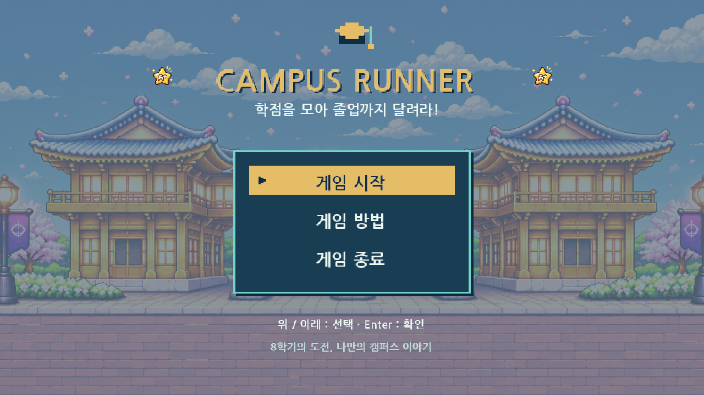
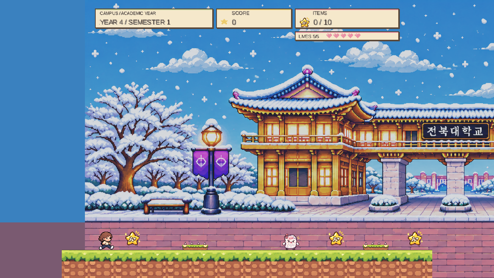
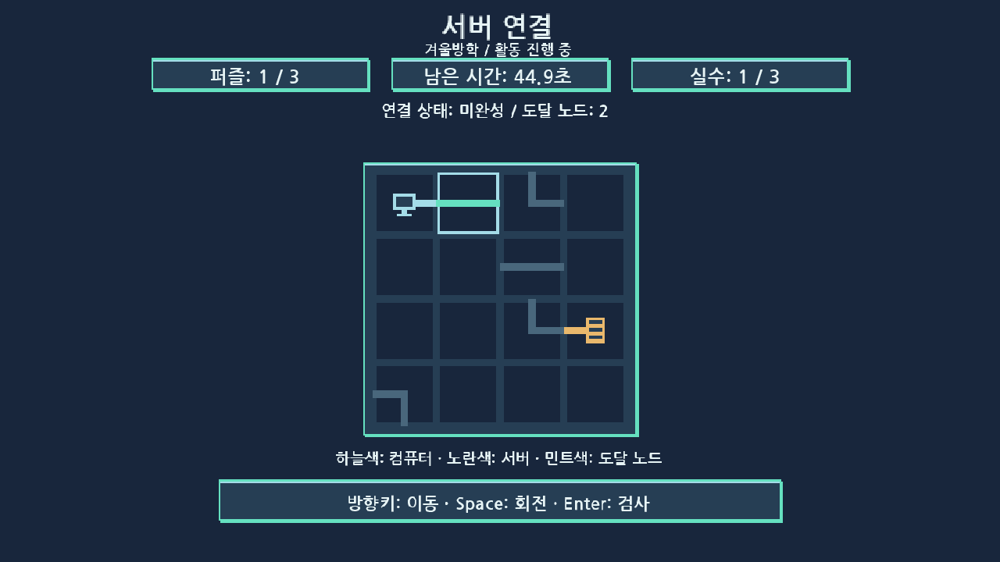
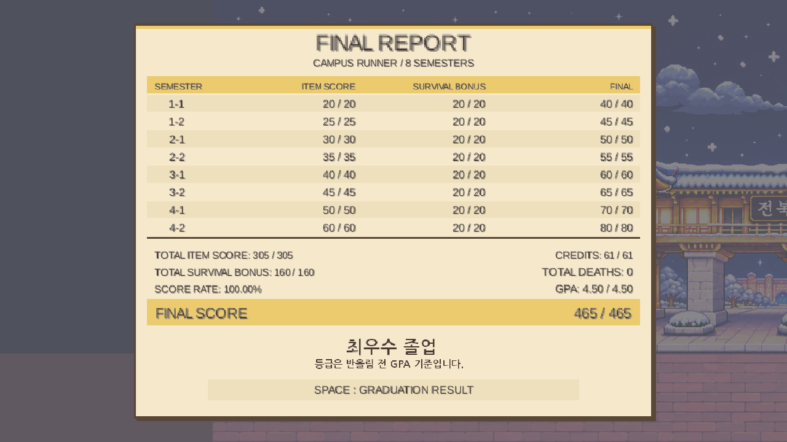
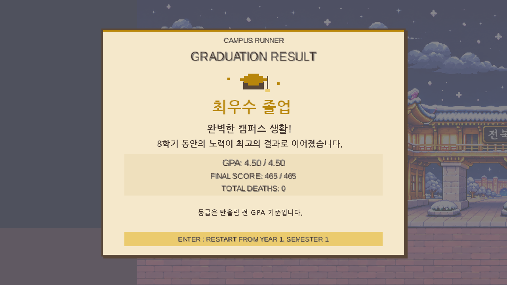

# Campus Runner

**학점을 모아 졸업까지 달려라!** 대학 생활을 소재로 한 2D 픽셀 아트 플랫폼 게임입니다.

1학년 1학기부터 4학년 2학기까지 달리며 A+ 학점 별을 모으고, 과제 몬스터와 가시를 피하세요. 방학 활동을 거쳐 최종 GPA에 따른 졸업 엔딩에 도전합니다.



## 게임 소개와 주요 기능

- 서로 다른 지형과 장애물을 가진 **8학기 스테이지**
- 계절별 캠퍼스 배경과 플레이어·발판·아이템·몬스터·함정 픽셀 아트
- A+ 학점 아이템 **총 61개**, 개당 5점
- 학기별 목숨과 사망 기록, 클리어 시 생존 보너스
- **카페 아르바이트 / 자격증 공부 / 서버 연결** 방학 미니게임
- 학기 성적표, 최종 성적표, 누적 점수 기반 **GPA 4.50 환산**
- 최우수 졸업·우수 졸업·일반 졸업·간신히 졸업·졸업 유예의 **5가지 엔딩**
- 키보드 타이틀 메뉴, 게임 방법, 일시정지·재시작·타이틀 복귀

아이템 만점은 305점, 생존 보너스 만점은 160점으로 **최종 만점은 465점**입니다. 생존 보너스는 학기별 `max(0, 20 - 사망 횟수 × 5)`이며, GPA는 `최종 점수 / 465 × 4.5`입니다. 실제 대학 성적 산정이 아닌 게임용 환산입니다. 엔딩 판정은 표시용으로 반올림하기 전 값을 사용합니다.

각 학기는 기본 목숨 5개로 시작합니다. 목숨이 남으면 현재 학기를 다시 시작하고, 전부 소진하면 GAME_OVER에서 새 게임을 선택할 때 모든 기록을 지우고 1-1부터 시작합니다. 카페 성공으로 받는 다음 학년의 추가 시작 목숨 효과는 별도로 적용됩니다.

## 다운로드 및 실행

**GitHub Releases v1.0.0은 이 작업에서 게시하지 않았습니다.** 로컬 Windows 후보본과 실행 안내를 준비했습니다. [최종 공개 점검표](docs/PUBLIC_RELEASE_REVIEW.md)에 확인된 권한, 사용자 진술에 근거한 이미지 출처, 남은 LGPL 대응 소스·깨끗한 PC 확인 사항을 구분했습니다. 존재하지 않는 ZIP 다운로드 주소를 확정 링크로 제공하지 않습니다.

공개 배포가 준비되면 저장소의 [Releases 페이지](https://github.com/One2-3/campus_runner/releases)에서 다음과 같이 실행합니다.

1. `CampusRunner-Windows-v1.0.0.zip`을 다운로드합니다.
2. ZIP 전체를 원하는 폴더에 **압축 해제**합니다.
3. `CampusRunner` 폴더 안의 **CampusRunner.exe**를 실행합니다.

Windows x64 대상이며 Java·Gradle·IDE를 별도로 설치할 필요가 없습니다. `app`, `runtime`, `licenses` 폴더를 EXE와 함께 유지하세요. EXE만 따로 옮기거나 ZIP 안에서 직접 실행하지 마세요. macOS·Linux 실행 파일은 이 배포본에 포함하지 않습니다.

## 조작 방법

| 화면/활동 | 키 | 동작 |
| --- | --- | --- |
| 스테이지 | ← / → | 이동 |
| 스테이지 | Space | 점프 |
| 스테이지·방학 활동 | Esc | 일시정지 / 재개 |
| 타이틀·일시정지·게임 오버 메뉴 | ↑ / ↓, Enter | 항목 이동, 선택 |
| 게임 방법 | Esc | 타이틀 메뉴로 복귀 |
| 학기 클리어 | Enter | 다음 학기·방학·최종 성적표로 진행 |
| 방학 시작·결과 | Enter | 시작 / 다음 학년 진행 |
| 카페 | ← / → | 쟁반 이동, 커피 +10점 / 쓰레기 -10점 |
| 자격증 | ↑ / ↓ / ← / → | 표시된 순서를 외운 뒤 같은 순서로 입력 |
| 서버 연결 | 방향키 / Space / Enter | 칸 선택 / 회로 회전 / 연결 검사 |
| 최종 성적표 | Space | 졸업 엔딩 확인 |
| 졸업 엔딩 | Enter | Stage 1부터 새 게임 |

방학은 2·4·6학기 클리어 확인 후 순서대로 진행됩니다. 방학 결과는 다음 학년 두 학기에 적용되고 학기 점수에는 합산하지 않습니다.

## 스크린샷

아래 이미지는 실제 게임 렌더링 캡처입니다. 최종 결과 화면은 표시 검증용 만점 데이터 예시입니다.

### 스테이지 플레이



### 서버 연결 미니게임



### 최종 성적표



### 졸업 엔딩



## 개발 환경

| 항목 | 설정 |
| --- | --- |
| 언어 | Java, 소스/타깃 호환성 8 |
| 검증한 빌드·패키징 JDK | Windows x64 Oracle JDK 17.0.12 |
| 프레임워크 | LibGDX 1.13.1 |
| 데스크톱 백엔드 | LWJGL3 (LWJGL 3.3.3) |
| 빌드 | Gradle Wrapper 8.14.3 |
| 개발 도구 | JDK·터미널, IDE는 선택 사항 (예: VS Code / IntelliJ IDEA) |

이 저장소는 대학 게임·혼합현실 과제로 시작했으며 [gdx-liftoff](https://github.com/libgdx/gdx-liftoff) 프로젝트 구조를 사용합니다.

- `core`: 게임 로직·공통 렌더러 및 검증 코드
- `lwjgl3`: 데스크톱 실행 진입점
- `assets`: 이미지·비트맵 폰트·셰이더
- `docs`: 설계·검증 문서와 README 선정 스크린샷
- `tools`: 폰트 생성·Windows 패키징 도구

## 개발자 빌드 및 실행

JDK 17을 설치하고 `JAVA_HOME`을 설정한 뒤 저장소 루트의 PowerShell에서 실행합니다. 최초 빌드에는 의존성 다운로드를 위한 인터넷 연결이 필요할 수 있습니다. 전역 Gradle 설치는 필요 없습니다.

```powershell
git clone https://github.com/One2-3/campus_runner.git
cd campus_runner
.\gradlew.bat build
.\gradlew.bat :lwjgl3:run
```

실행용 fat JAR만 생성하려면:

```powershell
.\gradlew.bat :lwjgl3:jar
java -jar .\lwjgl3\build\libs\Project2-1.0.0.jar
```

JAR 이름은 기존 `appName=Project2` 설정을 유지합니다. JAR에는 런타임 라이브러리와 assets가 포함되지만 Java 런타임 자체는 포함되지 않으므로, 일반 사용자는 Windows EXE ZIP을 사용하세요. `build`는 기존 30·60·120fps 회귀 검증도 실행합니다.

### Windows ZIP 재생성

`jpackage.exe`, `jlink.exe`가 포함된 Windows x64 JDK가 필요합니다. 도구나 JDK를 자동 설치하지 않습니다.

```powershell
& .\tools\PackageWindows.ps1 -JdkHome $env:JAVA_HOME
```

생성 위치:

```text
dist/
  CampusRunner/
    CampusRunner.exe
    app/
    runtime/
    licenses/
    START-HERE.txt
  CampusRunner-Windows-v1.0.0.zip
  CampusRunner-Windows-v1.0.0.zip.sha256
```

기존 배포본을 자동 삭제하거나 덮어쓰지 않습니다. 다시 만들 때는 `-OutputDirectory dist/rebuild`처럼 새 출력 폴더를 지정하세요. 자세한 패키징 검증과 한계는 [Windows 배포 문서](docs/WINDOWS_DISTRIBUTION.md)를 확인하세요.

## 라이선스 및 에셋

- **Campus Runner 자체 소스 코드에는 별도 오픈소스 라이선스를 부여하지 않습니다.** 자체 코드의 재사용·수정·재배포 권한을 별도로 부여하지 않았으며 GitHub 공개와 이용허락은 다릅니다. 외부 구성요소의 기존 라이선스와 GitHub 약관상 권리는 유지합니다. [소스 코드 권리 정책](docs/CODE_LICENSE_POLICY.md)을 확인하세요.
- LibGDX는 Apache 2.0, LWJGL은 BSD 3-Clause이며 네이티브 라이브러리에는 각각의 조건이 적용됩니다. OpenAL Soft는 별도의 LGPL 구성요소입니다.
- 타이틀·방학 한글 폰트는 NanumGothic 기반 SIL OFL 1.1 부분집합이며 고지를 포함합니다.
- 엔딩 폰트 `ending-ko`는 기존 나눔고딕 OFL 원본에서 **Campus Ending Korean**으로 재생성해 맑은 고딕 기반 변환 문제를 해결했습니다. 생성 도구와 고지를 함께 관리합니다.
- 제공된 게임 PNG와 런처 아이콘은 사용자 확인에 따라 GPT에서 파일 업로드 당일 만든 생성물로 기록했습니다. OpenAI 약관의 출력 권리 조항을 확인했으며, 정확한 생성 모델·날짜 및 입력 자료 권리 확인은 별도로 남깁니다. 임의의 CC0/MIT 라이선스를 부여하지 않습니다.
- 번들 런타임은 사용한 JDK 배포판·버전의 라이선스를 따릅니다. 현재 후보본의 Oracle 17.0.12는 NFTC 고지를 포함하며 유료 재배포까지 허용한다고 해석하지 않습니다.

원문과 출처, 미확인 항목은 [전체 라이선스 점검표](docs/LICENSE_AUDIT.md), [THIRD_PARTY_NOTICES.md](packaging/THIRD_PARTY_NOTICES.md) 및 배포본 `licenses/`, `runtime/legal/`을 확인하세요. 배포 후보본 생성은 모든 에셋 권리 검증이 완료되었다는 뜻이 아닙니다. OFL 엔딩 폰트와 최신 고지를 적용한 새 후보본은 `dist/license-reviewed/`에 있고, 기존 `dist/` 후보본과 구분합니다.
