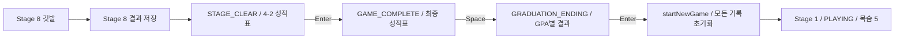

# Campus Runner — GPA별 졸업 엔딩

## STEP 10-10 픽셀 엔딩 UI (2026-11-08)

`EndingRenderer`에서 기존 enum의 제목·두 줄 메시지·강조색을 그대로 표시한다.
FinalReportRenderer와 PixelResultCanvas의 영어/한글 폰트·흰색 Texture를 공유한다.
FinalReport/GraduationEnding의 GPA·정수 점수 기준과 메시지 원문은 변경하지 않았다.

- 크림 패널·갈색 테두리/글씨·전체 창 어두운 오버레이로 다른 메뉴와 통일했다.
- 기본 패널 640×480, 기존 FitViewport로 균일 확대·중앙 정렬한다.
- 최우수: 기존 금색, 우수: 기존 파랑, 일반: 기존 초록, 간신히: 기존 주황, 유예: 기존 붉은 계열 강조.
- 성공 등급은 코드로 그린 계단형 졸업모와 작은 장식, 유예는 닫힌 노트 장식을 표시한다.
  유예에는 졸업 성공 메시지나 성공 장식을 표시하지 않는다.
- GPA/4.50, FINAL SCORE/465, TOTAL DEATHS는 같은 FinalReport에서 읽는다.
- 기존 PRECISION_NOTE를 두 화면 모두 표시한다. 반올림된 GPA 때문에 등급이 달라지지 않는다.
- 원본 PNG·폰트 파일을 수정하지 않고 Nearest를 적용한다.
  기존 한글 공백의 0 advance는 새 공유 폰트 인스턴스에서만 보정해 띄어쓰기를 읽기 쉽게 했다.

검증: 최종 Gradle build 및 30/60/120fps 기존 회귀 검증 통과.
0~465의 모든 점수 경계와 465점/GPA 4.50, 실제 부분 수집·사망 보너스·누적 사망 집계 검증 유지.
5개 등급을 800×600 / 1280×720 / 1920×1080 실제 GUI로 캡처하고 대표 화면을 확인했다.
5개 제목·색상·기존 메시지 정상, 잘림/겹침 없음.
동시 Space/Enter 및 키 유지가 화면을 여러 단계 건너뛰지 않으며,
성적표/엔딩의 월드 정지와 Enter 전체 초기화, 공유 리소스 해제를 확인했다.
상세 결과와 전체 변경 파일은 [FINAL_REPORT.md](FINAL_REPORT.md)의 STEP 10-10 절을 따른다.

- [엔딩 전후 비교](../build/final-pixel-gui/ending-before-after-800x600.png)
- [5개 엔딩 모음](../build/final-pixel-gui/five-endings.png)
- [최우수 800×600](../build/final-pixel-gui/after-ending-highest_honors-800x600.png)
- [우수 1280×720](../build/final-pixel-gui/after-ending-honors-1280x720.png)
- [일반 1920×1080](../build/final-pixel-gui/after-ending-graduated-1920x1080.png)
- [간신히 800×600](../build/final-pixel-gui/after-ending-barely_graduated-800x600.png)
- [유예 800×600](../build/final-pixel-gui/after-ending-deferred-800x600.png)

확인 범위에서 남은 GUI 문제는 없다. Git commit/push/merge는 실행하지 않았다.

## 등급과 정확한 판정

기존 `FinalReport`의 점수·GPA 계산과 저장된 8개 StageResult를 재사용한다.
`FinalReport.getEnding()`은 `GraduationEnding.fromScore(finalScore)`에 판정을 위임한다.
생존 보너스나 GPA를 별도로 재계산해 저장하지 않는다.

```text
finalScore = totalItemScore + totalSurvivalBonus
GPA = finalScore / 465.0 * 4.5
    = finalScore * 9 / 930
판정: finalScore * 9 >= (GPA 하한 * 2) * 465
```

| GPA 기준 (반올림 전) | 엔딩 | 정수 점수 범위 | 실제 5점 단위 점수 범위 | 강조색 |
| --- | --- | --- | --- | --- |
| 4.00 이상 | 최우수 졸업 | 414~465 | 415~465 | 금색 |
| 3.50 이상, 4.00 미만 | 우수 졸업 | 362~413 | 365~410 | 밝은 파랑 |
| 3.00 이상, 3.50 미만 | 일반 졸업 | 310~361 | 310~360 | 녹색 |
| 2.00 이상, 3.00 미만 | 간신히 졸업 | 207~309 | 210~305 | 주황 |
| 2.00 미만 | 졸업 유예 | 0~206 | 0~205 | 붉은 회색 |

부동소수점 오차와 UI 반올림을 피하기 위해 등급 하한을 두 배한 정수 8/7/6/4/0과 점수를 비교한다.
0~465 범위 밖의 점수는 잘못된 입력으로 거부한다. 게임용 GPA 산식은 변경하지 않는다.
GPA는 화면에서만 소수점 둘째 자리까지 표시한다. 예를 들어 정수 413점의 GPA는 약 3.99677이므로
화면에 4.00으로 표시되더라도 우수 졸업이다. 현재 아이템·보너스는 5점 단위라 413점은
실제 플레이에서 발생하지 않지만 이 경우도 자동 검증한다.
엔딩 화면에는 **“등급은 반올림 전 GPA 기준입니다.”**를 함께 표시한다.

## 성적표와 엔딩 흐름



성적표에서 Enter는 아무 동작도 하지 않는다. Space 입력은 별도 분기에서 처리한 뒤 즉시 반환하여
동시에 Enter를 눌러도 같은 프레임에 새 게임을 시작하지 않는다. 실제 키 입력은 기존
`isKeyJustPressed`를 사용하므로 키를 계속 누른 채로 화면을 연속 통과하지 않는다.
Stage 8 클리어 프레임에 누른 점프 Space로 성적표까지 생략하지 않도록 전환 처리는 다음 갱신부터 가능하다.
엔딩의 Space·ESC는 무시한다. 성적표와 엔딩에서는 월드 갱신을 수행하지 않는다.
Stage 9는 생성하지 않으며 GAME_OVER의 Enter 전체 초기화는 그대로 유지한다.

`Main.getFinalReport()`는 성적표와 엔딩 상태에서 같은 저장 결과와 실제 `totalDeathCount`를 제공한다.
엔딩 등급은 별도 가변 필드로 저장하지 않아 최종 점수와 불일치하거나 새 게임에 이전 등급이 남지 않는다.

## 화면과 메시지

기존 UI FitViewport(800×600), SpriteBatch·BitmapFont를 재사용한다.
모든 엔딩에 CAMPUS RUNNER, GRADUATION RESULT, 한글 등급, GPA / 4.50,
FINAL SCORE / 465, TOTAL DEATHS, 두 줄 메시지, 반올림 안내, Enter 재시작 안내를 표시한다.
등급 글자와 상단 강조 띠에 등급별 색을 사용하며 본문은 어두운 색으로 가독성을 유지한다.
창 크기에 따라 FitViewport가 전체 화면의 비율을 유지한다.

| 등급 | 첫 번째 메시지 | 두 번째 메시지 |
| --- | --- | --- |
| 최우수 졸업 | 완벽한 캠퍼스 생활! | 8학기 동안의 노력이 최고의 결과로 이어졌습니다. |
| 우수 졸업 | 노력의 결실! | 훌륭한 성적으로 캠퍼스를 떠납니다. |
| 일반 졸업 | 졸업 성공! | 수많은 도전을 이겨내고 마침내 졸업했습니다. |
| 간신히 졸업 | 아슬아슬한 졸업! | 쉽지 않았지만 끝까지 포기하지 않았습니다. |
| 졸업 유예 | 아직 졸업할 수 없습니다. | 학점이 부족합니다. 다시 도전해 보세요! |

졸업 유예는 `isGraduated() == false`인 실패 엔딩이다. 성공 문구를 표시하지 않는다.
목숨이 소진되어 발생한 GAME_OVER와 달리, 8학기를 모두 마친 결과를 유지하며 GPA 부족으로 유예되었다고 표시한다.

기본 BitmapFont에 한글이 없어 `assets/fonts/ending-ko.fnt`와 `ending-ko.png`를 추가했다.
ASCII와 실제 엔딩 문구에 필요한 한글을 합쳐 181개 글리프만 포함하며 TTF는 배포하지 않는다.
실행 시 시스템 폰트·네트워크·추가 라이브러리가 필요 없다.
개발용 `tools/GenerateEndingFont.ps1`은 STEP 10-16부터 기존 `tools/fonts/NanumGothic-Bold.ttf` (SIL OFL 1.1)에서 이 글리프를 래스터화한다. 파생물 이름은 Campus Ending Korean이며 ending-ko-OFL.txt를 함께 배포한다. 이전 맑은 고딕 파생 아틀라스는 새 후보본에서 교체했다.
저장소 루트에서 실행하면 enum의 문구를 읽어 아틀라스를 다시 만들 수 있다.
문구 변경 후에는 스크립트를 재실행하고 글리프 검증을 통과해야 한다.

## 전체 초기화

엔딩 Enter와 GAME_OVER Enter는 공통 `startNewGame()`을 호출한다.
모든 StageResult·학기별 아이템 점수·생존 보너스·최종 점수·학기별 사망 기록을 삭제하고,
`semesterDeathCount`와 `totalDeathCount`를 0으로 만든다. 누적 점수는 결과 슬롯이 비면서 0이 된다.
Stage 1 원본에서 플레이어·아이템·적·가시·이동 발판·카메라를 다시 만들고 목숨 5·PLAYING으로 시작한다.
성적표와 엔딩은 완료 상태에서만 표시하므로 새 게임에서 이전 화면이나 데이터가 나타나지 않는다.
플레이 HUD는 기존대로 사망 횟수와 생존 보너스를 공개하지 않는다.

## 자동 검증 결과

`.\gradlew.bat build` 성공. JDK 17에서 Java 8 소스 호환을 유지하며 실행했다.
`GraduationEndingVerification`을 기존 Gradle 검증 체인에 추가했다.

| 검증 항목 | 30fps | 60fps | 120fps |
| --- | --- | --- | --- |
| Stage 8 결과 저장 후 성적표 진입 | 통과 | 통과 | 통과 |
| Space로 엔딩·Enter로 전체 초기화·Stage 1 진입 | 통과 | 통과 | 통과 |
| 성적표 Enter 무시·Space/Enter 동시 입력 보호 | 통과 | 통과 | 통과 |
| 최우수/우수/일반/간신히/유예 다섯 화면의 판정 데이터 | 통과 | 통과 | 통과 |
| GPA·최종 점수·실제 누적 사망 보존 | 통과 | 통과 | 통과 |
| 성적표·엔딩에서 월드 정지 및 Stage 9 방지 | 통과 | 통과 | 통과 |
| 엔딩 후 점수·사망·결과 삭제 및 런타임 교체 | 통과 | 통과 | 통과 |
| 기존 GAME_OVER·목숨 5개·누적 사망·보너스·465점 회귀 | 통과 | 통과 | 통과 |
| Stage 1~8 실제 이동·점프 경로 및 충돌 회귀 | 통과 | 통과 | 통과 |

추가 단위 검증:

- 정수 점수 **0~465 전체 466개**를 독립적인 점수 구간표와 비교한다. 206/207, 309/310, 361/362, 413/414를 포함한다.
- 413점의 표시 GPA 4.00이 실제 등급을 승격시키지 않는지 확인한다.
- 465/400/345/250/100점으로 다섯 엔딩을 확인하고, 5점 단위 여러 점수에서 FinalReport의 GPA와 등급을 대조한다.
- 졸업 유예의 실패 문구를 정확히 대조하고 성공 여부가 false인지 확인한다.
- 다섯 색상이 서로 다르고, 한글 문구의 모든 글리프가 있으며 텍스트 폭이 700 UI 단위 이내인지 확인한다.

다섯 화면별 입력 검증은 완료된 결과를 넣은 테스트 픽스처를 사용한다.
Stage 8의 실제 클리어 후 성적표 진입과 점수 저장은 기존 FinalReportVerification 및
8개 스테이지 실제 입력 회귀 검증을 그대로 유지하여 확인한다.
기존 테스트의 결과·점수·충돌 조건을 완화하지 않았다. 완료 화면 재시작 입력만
새로 요청한 성적표 → Space → 엔딩 → Enter 순서로 변경하고 중간 상태 검증을 추가했다.

## GUI 수동 테스트 항목 (미실행)

- Stage 8 클리어 직후 성적표가 먼저 보이고 Space를 눌러야 엔딩으로 이동하는지 확인.
- 다섯 등급의 한글 제목·두 줄 메시지·강조색을 확인하고 졸업 유예에 성공 문구가 없는지 확인.
- GPA·최종 점수·TOTAL DEATHS가 성적표와 일치하는지 확인.
- 800×600, 1280×720 및 작은/큰 창에서 글자가 겹치거나 잘리지 않는지 확인.
- 한글 글리프의 가독성, 행 간격, 반올림 안내와 재시작 안내를 확인.
- Space·Enter 동시 입력이나 키를 누른 상태로 성적표/엔딩이 연속 생략되지 않는지 확인.
- 성적표·엔딩의 이동/점프/ESC 입력으로 게임이 진행되지 않는지 확인.
- 엔딩 Enter와 GAME_OVER Enter가 모두 Stage 1·목숨 5·점수/사망 0으로 돌아가는지 확인.

## 변경 파일

- `Main.java`, `GameState.java`: 엔딩 상태·화면·입력 전환.
- `FinalReport.java`, `GraduationEnding.java`: 기존 집계 결과와 정확한 다섯 등급 연결.
- `GraduationEndingVerification.java`: 등급·경계값·폰트·입력·초기화 검증 추가.
- `FinalReportVerification.java`, `LifeSystemVerification.java`, `FreshmanLevelVerification.java`, `SeniorSemester2Verification.java`: 새 화면 순서 검증 및 호출 연결.
- `assets/fonts/ending-ko.fnt`, `assets/fonts/ending-ko.png`, `tools/GenerateEndingFont.ps1`: 한글 비트맵 폰트와 재생성 도구.
- `docs/GRADUATION_ENDINGS.md`, `docs/FINAL_REPORT.md`, `docs/LIFE_SYSTEM.md`: 현재 화면/입력 규칙과 검증 기록.

Stage 1~8 데이터·Player 물리·StageResult 및 생존 보너스 계산은 변경하지 않았다.
Git commit·push·merge는 실행하지 않는다.
