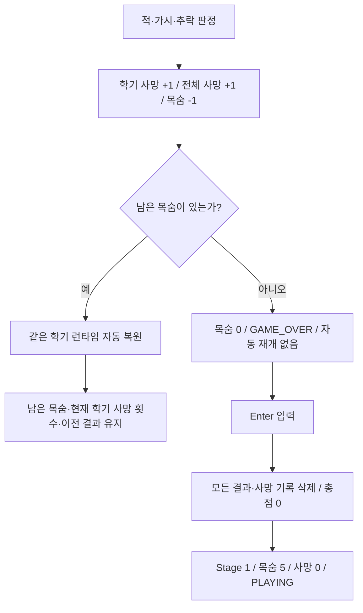

# Campus Runner — 목숨·누적 사망·생존 보너스 규칙

모든 학기는 목숨 5개로 시작한다. 적·가시 접촉 또는 추락으로 사망하면 정확히 1개를 잃는다.
남은 목숨이 있으면 같은 학기를 **자동으로** 처음부터 다시 시작한다.
어느 학기에서든 다섯 번째로 사망하면 목숨 0·GAME_OVER로 멈추며,
Enter를 누를 때 모든 진행 기록을 삭제하고 반드시 Stage 1(1학년 1학기)부터 새 게임을 시작한다.
목숨 소진 후 현재 학기부터 재개하는 기능은 없다.

이 문서는 기존 레벨 문서의 이전 단일 사망 GAME_OVER·Enter 현재 학기 재시작 설명과
아이템만 포함하던 누적 점수 설명을 대체한다. 레벨 좌표·물리·아이템 기본 점수는 유지한다.

## 사망과 재시작 흐름



한 프레임에 적과 가시가 동시에 닿아도 사망 처리는 한 번만 실행한다.
실패가 깃발보다 우선하며, 사망 처리를 마친 프레임에는 클리어 판정이나 새 런타임 물리 갱신을 하지 않는다.
GAME_OVER·PAUSED·STAGE_CLEAR·GAME_COMPLETE에서는 추가 피해를 처리하지 않는다.

## 학기 사망과 전체 누적 사망

`Main`의 기존 `semesterDeathCount`와 학기별 `semesterDeaths` 기록은 유지하고,
현재 게임 도전 전체를 나타내는 `totalDeathCount` 필드 하나를 추가했다.
적·가시·추락을 합친 기존 사망 분기에서 두 카운터를 각각 한 번 증가시킨다.
동시에 여러 위험 요소와 접촉해도 한 번만 증가하며, 사망 처리 후 즉시 반환한다.

| 시점 | semesterDeathCount (DEATHS) | totalDeathCount (TOTAL DEATHS) |
| --- | --- | --- |
| 최초 새 게임 | 0 | 0 |
| 사망 | +1 | +1 |
| 남은 목숨으로 현재 학기 자동 재시작 | 유지 | 유지 |
| 다음 학기 정상 진입 | 0 | 유지 |
| 다섯 번째 사망 및 GAME_OVER 대기 | 5 유지 | 다섯 번째 사망까지 누적한 값 유지 |
| GAME_OVER에서 Enter로 새 게임 | 0 | 0 |
| Stage 8 클리어 및 GAME_COMPLETE 대기 | 유지 | 유지 |

누적 카운터는 `loadStage()`와 런타임 복원에서 초기화하지 않는다.
초기화는 `startNewGame()`에서만 수행한다. 기존 GAME_COMPLETE 화면에서도
Enter는 새 게임을 시작하므로 이때 모든 결과와 누적 사망을 함께 초기화한다.
완료 상태에 머무는 동안에는 값을 보존하며 최종 성적표에서 공개한다.
누적 사망은 점수·생존 보너스 계산에 사용하지 않는다.

### 목숨이 1~4개 남은 자동 재시작

다음 상태를 현재 학기 원본에서 새로 만든다.

- 플레이어 위치·속도·탑승 상태
- 미수집 아이템과 해당 학기 아이템 점수 0점·수집 개수 0개
- 적의 초기 위치·방향
- 가시의 초기 상태·위상
- 이동 발판의 초기 위치·위상
- 카메라의 현재 학기 시작 위치

남은 목숨과 현재 학기의 누적 사망 횟수는 유지한다. 이전 학기의 확정 결과도 유지한다.
Enter를 누를 필요가 없고, 플레이 중 Enter를 눌러도 목숨이나 사망 횟수가 초기화되지 않는다.

### 다섯 번째 사망

사망 횟수는 5, 목숨은 0이 된다. 현재 Stage 번호와 실패한 런타임은 그대로 두고 GAME_OVER로 멈춘다.
그 순간 현재 학기를 자동으로 재시작하거나 다음 학기로 진행하지 않는다.
이전 확정 기록은 GAME_OVER 표시 중에는 보존되며, 새 게임 입력을 받으면 삭제한다.

### GAME_OVER의 Enter

`startNewGame()`을 호출하여 다음을 함께 수행한다.

- 8개 StageResult 슬롯을 모두 비움: 모든 아이템 점수·수집 개수·사망 횟수·생존 보너스·최종 점수 삭제
- 8개 학기 사망 기록을 모두 0으로 초기화
- 전체 누적 사망 횟수 `totalDeathCount`를 0으로 초기화
- Stage 1 로드, 목숨 5개·현재 사망 횟수 0·현재 아이템 점수 0·수집 개수 0
- Stage 1의 플레이어·아이템·장애물·카메라를 원본 초기 상태로 생성
- PLAYING으로 전환

총점은 확정 결과의 합계이므로 결과 슬롯을 비우면 0이다.
다른 학기의 객체는 플레이 중에만 생성되며, 이후 정상 진입할 때 해당 학기 원본 초기 상태에서 생성된다.

## 정상 학기 진행과 보너스

학기를 클리어할 때만 결과와 보너스를 한 번 확정한다.

| 현재 학기 사망 횟수 | 클리어 시 남은 목숨 | 생존 보너스 |
| --- | ---: | ---: |
| 0 | 5 | +20 |
| 1 | 4 | +15 |
| 2 | 3 | +10 |
| 3 | 2 | +5 |
| 4 | 1 | +0 |

```text
survivalBonus = max(0, 20 - semesterDeathCount * 5)
semesterFinalScore = itemScore + survivalBonus
totalScore = sum(completedSemesterFinalScores)
```

아직 클리어하지 않은 학기의 보너스와 아이템 점수는 전체 확정 총점에 포함하지 않는다.
학기 클리어 후 Enter로 다음 학기에 진입하면 새 목숨 5개·새 사망 횟수 0으로 시작한다.
이전 학기의 기록은 그 상태로 유지한다.
Stage 8을 클리어하면 결과를 저장하고 기존 GAME_COMPLETE로 전환한다. Stage 9는 생성하지 않는다.
GAME_COMPLETE 화면의 Enter는 기존 새 게임 동작이며, 모든 결과를 지우고 Stage 1을 시작한다.

### StageResult 조회

결과 객체는 클리어 후 변경하지 않는다.

- `getItemScore()`: 아이템 점수
- `getCollectedItemCount()`: 수집 개수
- `getDeathCount()`: 해당 학기 사망 횟수
- `getSurvivalBonus()`: 확정 생존 보너스
- `getFinalScore()` 및 `getScore()`: 아이템 점수 + 생존 보너스

기존 아이템 수집 검증은 getItemScore()로 명확히 분리했다.
기존 3인자 StageResult 생성자는 사망 0회 결과로 위임하고,
실제 게임 저장은 사망 횟수를 받는 4인자 생성자를 사용한다.

### 전체 무사망 만점

| Stage | 아이템 만점 | 무사망 보너스 | 학기 최종 만점 |
| --- | ---: | ---: | ---: |
| 1 | 20 | 20 | 40 |
| 2 | 25 | 20 | 45 |
| 3 | 30 | 20 | 50 |
| 4 | 35 | 20 | 55 |
| 5 | 40 | 20 | 60 |
| 6 | 45 | 20 | 65 |
| 7 | 50 | 20 | 70 |
| 8 | 60 | 20 | 80 |
| 합계 | 305 | 160 | **465** |

## HUD와 GAME_OVER 화면

플레이 HUD는 기존 YEAR·SEMESTER·ITEMS·SCORE와 오른쪽 위 LIVES만 표시한다.
LIVES 아래에 하트 5개를 그린다. 남은 목숨은 빨간색, 소진한 목숨은 연한 회색이다.
기존 ShapeRenderer의 원과 삼각형을 사용하므로 외부 이미지나 폰트 글리프를 추가하지 않는다.
DEATHS·TOTAL DEATHS 및 생존 보너스는 플레이 HUD에 표시하지 않는다.
표시만 숨기며 학기별·전체 사망 집계, 생존 보너스, StageResult 저장은 그대로 유지한다.

```text
LIVES: 남은 목숨 / 5
SCORE: 현재 학기 아이템 점수
ITEMS: 수집 개수 / 현재 Stage 전체 개수
```

HUD SCORE에는 생존 보너스를 더하지 않는다. 완료 시 최종 성적표의 FINAL SCORE에 확정 최종 점수 합계를 표시한다.
학기별 아이템 점수·사망 횟수·보너스·최종 점수와 전체 누적 사망·전체 최종 점수(만점 465)를 보존한다.
성적표 집계와 화면은 [FINAL_REPORT.md](FINAL_REPORT.md)를 따른다.
기존 글꼴·중앙 정렬·입력 체계로 GAME_OVER 화면에 다음 네 줄을 표시한다.

```text
GAME OVER
ALL LIVES LOST
RESTART FROM YEAR 1, SEMESTER 1
PRESS ENTER TO RESTART
```

최종 성적표와 게임용 GPA는 별도 STEP 7-2에서 추가했다. 엔딩 분기는 구현하지 않는다.

## 변경 파일

| 파일 | 변경 |
| --- | --- |
| `core/src/main/java/io/jbnu/test/Main.java` | 목숨·사망 기록, 자동 재시작과 전체 새 게임 분리, HUD·안내, 최종 점수 합계 |
| `core/src/main/java/io/jbnu/test/StageResult.java` | 아이템 점수·사망 횟수·보너스·최종 점수 기록 |
| `core/src/test/java/io/jbnu/test/LifeSystemVerification.java` | 새 목숨 규칙·초기화·보너스·최대 점수 전용 검증 |
| `core/src/test/java/io/jbnu/test/LifeVerificationSupport.java` | 자동 복원 전 실제 충돌 객체 보존과 정확한 목숨 차감 관찰 |
| `core/src/test/java/io/jbnu/test/FreshmanLevelVerification.java` | Stage 1·8학기 생명주기 기대값 변경, 전용 목숨 검증 호출 |
| `core/src/test/java/io/jbnu/test/Semester2LevelVerification.java` | Stage 2 자동 재시작·아이템 점수 검증 |
| `core/src/test/java/io/jbnu/test/SophomoreLevelVerification.java` | Stage 3 자동 재시작·보너스 포함 총점 검증 |
| `core/src/test/java/io/jbnu/test/SophomoreSemester2Verification.java` | Stage 4 실제 충돌·자동 복원 관찰 |
| `core/src/test/java/io/jbnu/test/JuniorSemester1Verification.java` | Stage 5 실제 충돌·자동 복원 관찰 |
| `core/src/test/java/io/jbnu/test/JuniorSemester2Verification.java` | Stage 6 실제 충돌·자동 복원 관찰 |
| `core/src/test/java/io/jbnu/test/SeniorSemester1Verification.java` | Stage 7 실제 충돌·자동 복원 관찰 |
| `core/src/test/java/io/jbnu/test/SeniorSemester2Verification.java` | Stage 8 실제 충돌·자동 복원·완료 총점 관찰 |
| `docs/LIFE_SYSTEM.md` | 최종 규칙과 검증 기록 |

StageFactory·StageDefinition, 8개 맵 데이터, Player 물리, 적·가시·발판 동작, GameState는 변경하지 않았다.
새 라이브러리와 불필요한 게임 구조 리팩터링은 추가하지 않았다.
기존 레벨 문서의 아이템 기본 점수와 좌표는 그대로이며 최종 점수·재시작 규칙은 이 문서를 따른다.

## 자동 검증

기존 `core:verifyFreshman`에 LifeSystemVerification을 연결해 `.\gradlew.bat build`에서 함께 실행한다.
JDK 17에서 build 성공. Java 8 소스 호환성을 유지했다.

| 검증 항목 | 30fps | 60fps | 120fps |
| --- | --- | --- | --- |
| 모든 학기 시작 목숨 5·사망 0 | 통과 | 통과 | 통과 |
| 사망당 정확히 목숨 1개·사망 +1 | 통과 | 통과 | 통과 |
| 남은 목숨 1~4에서 같은 학기 자동 복원 | 통과 | 통과 | 통과 |
| 아이템 점수 초기화·사망 횟수 유지 | 통과 | 통과 | 통과 |
| 모든 학기 5번째 사망 GAME_OVER, 자동 진입 없음 | 통과 | 통과 | 통과 |
| Stage 1·4·8 포함 모든 학기 소진 후 Stage 1 새 게임 | 통과 | 통과 | 통과 |
| 이전 결과·점수·보너스·모든 사망 기록 완전 삭제 | 통과 | 통과 | 통과 |
| 정상 다음 학기 진입 시 목숨 5·사망 0, 이전 기록 유지 | 통과 | 통과 | 통과 |
| 모든 학기에서 사망 0~4회 보너스 20/15/10/5/0 | 통과 | 통과 | 통과 |
| 보너스는 클리어 때 한 번만 확정 | 통과 | 통과 | 통과 |
| 전체 무사망 만점 465점·Stage 8 GAME_COMPLETE | 통과 | 통과 | 통과 |
| 동시 적·가시 접촉 시 목숨 1개만 차감 | 통과 | 통과 | 통과 |
| 정지 중 피해 없음·재개 후 한 번 차감 | 통과 | 통과 | 통과 |
| 실제 키 입력으로 연속 다섯 번 추락 후 전체 재시작 | 통과 | 통과 | 통과 |
| 기존 8개 스테이지 실제 입력·분기·충돌·카메라 회귀 | 통과 | 통과 | 통과 |
| 최초 누적 사망 0·자동 재시작 후 유지 | 통과 | 통과 | 통과 |
| 동시 충돌에도 두 사망 카운터 각각 정확히 +1 | 통과 | 통과 | 통과 |
| Stage 1~8 누적·학기 전환 시 DEATHS만 초기화 | 통과 | 통과 | 통과 |
| 모든 학기의 GAME_OVER 대기 중 누적 유지·Enter에서 0 | 통과 | 통과 | 통과 |
| 누적 16회 사망 후 GAME_COMPLETE 유지·Stage 9 방지 | 통과 | 통과 | 통과 |
| 누적 사망과 무관한 학기별 보너스·총점 385 검증 | 통과 | 통과 | 통과 |

누적 검증은 학기별 사망을 1/2/3/4/0/1/2/3회로 구성해 전체 16회와
아이템 305점 + 생존 보너스 80점 = 385점을 확인한다. 완료 대기 후에도 값이 유지되고,
Enter로 새 게임을 시작하면 모든 점수·결과·학기 사망·누적 사망이 0으로 돌아오는지 확인한다.
기존 8개 맵 실제 입력 회귀에서도 충돌 프레임당 누적 +1과 전체 학기 사망 합계를 대조한다.

전용 생명주기 검증은 점수·보너스·전체 삭제를 분리해 확인하기 위해 기존 Player.reset으로
아이템·깃발·추락 위치를 구성하는 제어된 테스트 픽스처도 사용한다. 목숨·사망 횟수·결과 객체를 직접 수정하지 않고
실제 Main.update의 수집·사망·클리어·전환을 실행한다. 실제 키 입력 추락 반복 검증과 기존 8개 맵의 실제 입력 완주는 별도로 유지한다.
동시 피격은 테스트 런타임에만 적과 가시를 겹치게 추가하고 한 번 차감 및 원본 객체 복원을 확인한다. 맵 데이터는 수정하지 않는다.

기존 충돌 검사는 자동 재시작 후 새 객체가 생기는 점을 반영해 실패 프레임의 플레이어·함정·적 참조를 보존한다.
실제 접촉과 정확한 목숨 감소를 확인하고, 입력 없이 이미 같은 학기가 초기화되었는지도 확인한다.
이전의 “첫 사망=GAME_OVER, Enter=현재 학기 재시작” 기대값만 새 규칙으로 변경했다.
경로·착지·아이템 개수·물리·충돌 판정 검사를 생략하거나 강제로 성공 처리하지 않았다.

## GUI 확인 항목 (미실행)

- LIVES 5 / 5와 빨간 하트 5개가 표시되고, 피해 후 목숨 숫자와 하트가 함께 줄어드는지 확인.
- DEATHS·TOTAL DEATHS·생존 보너스가 플레이 HUD에 표시되지 않는지 확인.
- 목숨 숫자·하트가 기존 YEAR·SEMESTER·ITEMS·SCORE와 겹치거나 잘리지 않는지 확인.
- 첫 네 번 피해가 별도 키 없이 같은 학기 시작으로 돌아가고 아이템 점수가 0이 되는지 확인.
- 다섯 번째 피해 후 GAME_OVER와 전체 재시작 네 줄 안내가 겹치거나 잘리지 않는지 확인.
- Stage 4·8에서 소진 후 Enter를 눌러 Stage 1·목숨 5·점수 0으로 돌아오는지 확인.
- 정상 학기 전환의 목숨 회복과 기존 완료 화면 총점이 보너스를 포함하는지 확인.
- 오른쪽 HUD가 높은 발판·플레이어·기존 정보의 시인성을 해치지 않는지 확인.
- ESC와 GAME_COMPLETE 입력이 기존 방식으로 동작하는지 확인.

Git commit, push, merge는 실행하지 않았다.
