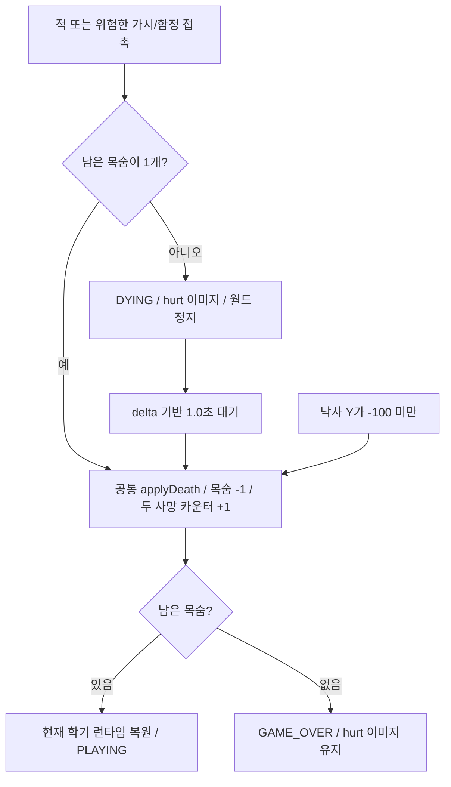

# Campus Runner — 플레이어 픽셀 아트·피격 연출 (STEP 10-2 / 10-2-1)

플레이어만 제공된 투명 PNG로 그린다. Stage 1~8 맵, 충돌, 물리, 목숨, 아이템,
방학 효과, 미니게임, 성적표와 엔딩은 변경하지 않는다.
기존 `assets/player.png`는 더 이상 플레이어 렌더링에 로드하지 않지만 파일은 삭제하지 않았다.
제공된 PNG 원본도 수정하지 않았다.

## 사용 이미지와 상태

모든 경로의 기준은 `assets/pixel/characters/player/`다.

| 상태 | 조건 | 파일 |
| --- | --- | --- |
| 대기 | grounded이며 수평 이동 속도가 0 | idle_01.png |
| 이동 | grounded이며 수평 이동 속도가 0이 아님 | run_02.png |
| 상승·낙하 | grounded가 아님 | jump_01.png |
| 피격 | 목숨 2개 이상 접촉 후 1초간 DYING, 마지막 목숨은 즉시 GAME_OVER | hurt_01.png |

`run_01.png`는 로드하거나 참조하지 않는다. 달리기 프레임 교체·애니메이션 타이머는 없다.
`PlayerSprites.selectPose()`는 피격 → 공중 → 이동/대기 순서로 이미지를 선택한다.
수평 이동은 기존 velocityX를 읽으므로 이동 발판이 플레이어를 운반해도 입력이 없으면 대기 상태다.
일시정지는 마지막 플레이어 상태를 그대로 그린다.

### 피격 상태와 사망 흐름 (STEP 10-2-1)

기존 적·고정 가시·ACTIVE 시간제 가시/함정 충돌 조건을 그대로 사용한다.
접촉을 감지하면 남은 목숨부터 확인한다.
**2개 이상**이면 `DYING`으로 전환하고 `HitFeedback`의 1초 타이머를 한 번 시작한다.
이 경우 진입 프레임에는 목숨·학기 사망·TOTAL DEATHS를 차감/증가시키지 않는다.
**1개**이면 피격 효과를 초기화하고 `applyDeath()`를 즉시 호출해 GAME_OVER를 표시한다.
마지막 목숨에는 DYING 진입·1초 타이머·흔들림을 시작하지 않는다.
피격 중에는 플레이어 위치·방향·32×44 충돌 박스와 모든 월드 객체를 유지하고,
이동·점프·Enter·Space·R·ESC, 추가 충돌·아이템 수집·깃발 클리어를 처리하지 않는다.



`HitFeedback.advance()`는 완료를 한 번만 반환한다. DYING 분기는 입력 처리보다 먼저 실행하고 즉시 반환하므로
키 입력으로 연출을 건너뛰거나 동일 접촉으로 타이머를 다시 시작할 수 없다.
일반 피격은 1초가 되면 낙사·마지막 목숨 접촉과 공유하는 `applyDeath()`를 호출한다. 목숨과 사망 카운터를 각각 한 번만 변경하며,
남은 목숨에 따라 기존 같은 학기 재시작 또는 GAME_OVER로 전환한다.
현재 학기 아이템·점수는 재시작 때 복원/초기화하고, 이전 학기 결과·누적 사망·방학 효과·남은 목숨은 유지한다.
카페 보너스의 6개 목숨, GAME_OVER Enter 전체 초기화, 생존 보너스 계산식은 그대로다.

피격 종료 순간 이동/Space/Enter/R/ESC가 눌려 있으면 해제될 때까지 입력 복귀를 대기한다.
이 짧은 대기 동안에도 플레이 갱신을 하지 않는다. 모든 키를 놓은 프레임은 중립 프레임으로 소비하고,
그 다음부터 새 입력을 받으므로 피격 중 누른 키로 부활 직후 점프·이동·일시정지·새 게임이 발생하지 않는다.
종료 순간 눌린 키가 없으면 추가 대기 없이 기존 흐름으로 복귀한다.

DYING과 GAME_OVER에서는 hurt 이미지를 적·가시 렌더링 뒤에 그려 접촉한 위험 요소에 가려지지 않게 한다.
일반 플레이의 렌더 순서는 유지한다. 피격 직전의 방향과 같은 crop·크기·발 앵커를 사용한다.

### 화면 흔들림

| 설정 | 값 |
| --- | --- |
| 피격 총 시간 | 1.0초 |
| 흔들림 시간 | 처음 0.25초 |
| 최대 오프셋 벡터 길이 | 월드 5단위 |
| 진폭 | 5 × (1 - 경과시간 / 0.25), 선형 감소 |
| 진동 | delta 누적 시간 기준 20Hz sin/cos |

`camera.combined`를 복사한 월드 렌더 행렬에만 음의 오프셋을 곱한다.
플레이어 위치·카메라 position·실제 추적 행렬을 바꾸거나 이전 오프셋에 더하지 않는다.
플랫폼·적·함정·아이템·플레이어 모두 같은 월드 렌더 행렬을 사용하고,
HUD는 기존 uiCamera를 사용하므로 흔들리지 않는다.
0.25초부터 오프셋은 정확히 0이며, 부활·새 게임은 피격 상태도 초기화한다.

### 낙사 정책

낙사는 화면 아래에서 발생해 피격 그림을 보여주기 어려우므로 기존 즉시 사망 처리를 유지한다.
낙사에는 DYING 대기나 흔들림을 추가하지 않는다. 이를 보여주기 위한 위치·카메라 이동도 하지 않는다.
마지막 낙사 후 GAME_OVER에서는 hurt를 선택하지만 이미 화면 밖이어서 보이지 않을 수 있다.

## PNG 영역과 렌더링 크기

네 PNG의 캔버스는 모두 448×512다. alpha가 0보다 큰 모든 픽셀을 조사해 다음 영역을 확인했다.
좌표는 PNG 왼쪽 위 기준이며 크기는 경계 픽셀을 포함한다.

| 파일 | crop X,Y | crop 너비×높이 | 발끝의 아래쪽 경계 Y | 실제 월드 표시 너비×높이 |
| --- | --- | --- | ---: | --- |
| idle_01.png | 86,56 | 276×394 | 450 | 30.82×44.00 |
| run_02.png | 87,56 | 274×390 | 446 | 30.60×43.55 |
| jump_01.png | 72,56 | 304×360 | 416 | 33.95×40.20 |
| hurt_01.png | 46,48 | 356×422 | 470 | 39.76×47.13 |

`PlayerSprites`는 TextureRegion으로 투명 여백을 제외하고 그린다. PNG 전체를 32×44로 누르거나
프레임마다 32×44로 늘리지 않는다. 공통 배율은 **44 / 394 ≈ 0.111675**로,
대기의 실제 캐릭터 높이를 기존 월드 높이 44에 맞춘다. 모든 포즈에 같은 배율을 사용해 머리/몸 크기와 이미지 비율을 보존한다.
점프는 다리 자세 때문에 높이가 줄어들고, 피격은 놀람 장식 때문에 너비/높이가 더 크다.
이러한 그림의 차이를 충돌 크기에 반영하지 않는다.

모든 crop의 수평 중심은 원본 캔버스 X=224다. 각 crop의 아래쪽은 해당 포즈의 발끝이므로,
다음과 같이 같은 중심·발 위치를 사용한다.

```text
drawWidth  = cropWidth  * (44 / 394)
drawHeight = cropHeight * (44 / 394)
drawX = player.getCenterX() - drawWidth / 2
drawY = player.getY()
```

중심 기준 X 오프셋은 대기 -15.41, 이동 -15.30, 점프 -16.97, 피격 -19.88 월드 단위다.
발 기준 Y 오프셋은 전부 0이다. 포즈와 방향이 바뀌어도 좌우 중심과 발 앵커는 동일하다.
월드 위치의 소수점 값을 그대로 사용하며 기존 카메라 추적·viewport는 변경하지 않는다.

## 방향과 충돌 분리

Player에 렌더링용 `facingRight`만 저장한다. 기존 velocityX가 양수이면 오른쪽, 음수이면 왼쪽으로 갱신하고,
0일 때는 이전 방향을 유지한다. 새 플레이어/재시작은 기본 오른쪽이다.
원본 TextureRegion과 좌우 반전한 TextureRegion을 초기화 때 각각 준비하고, 그릴 때 방향에 맞게 선택한다.
실행 중 원본 영역을 반복 flip하지 않아 방향 전환이 누적되거나 다른 프레임을 변경하지 않는다.

기존 충돌 Rectangle은 **32×44**로 그대로다. PlayerSprites는 이 Rectangle을 수정하거나 보관하지 않는다.
Player의 기존 렌더 메서드만 별도 클래스로 옮기고, Main은 같은 SpriteBatch 렌더 위치에서 새 그림을 그린다.
Player 변경은 방향 기록·상태 읽기 getter이며 이동·점프·중력·착지·발판 충돌 계산은 그대로다.
MOVE_SPEED=260, JUMP_SPEED=650, GRAVITY=1700과 기존 PlayerModifier 배율 적용도 동일하다.

## 리소스 수명과 필터

Main.create에서 PlayerSprites를 한 번 생성하고 네 Texture를 로드한다.
각 Texture의 min/mag filter는 모두 **TextureFilter.Nearest**다. mipmap·추가 보간은 사용하지 않는다.
스테이지 이동·사망 재시작·이미지 상태 전환에서 Texture를 새로 만들지 않는다.
종료 때 Main.dispose가 PlayerSprites.dispose를 호출하여 네 텍스처를 해제한다.
로드 실패 또는 448×512 규격 불일치는 파일 경로를 포함한 GdxRuntimeException으로 보고한다.
일부만 로드한 상태에서 실패하면 이미 로드한 플레이어 텍스처를 먼저 해제한다.
다른 오브젝트 텍스처·폰트·배경·HUD는 변경하지 않았다.

## 자동 검증 결과

`.\gradlew.bat build` 성공. JDK 17에서 실행했으며 Java 8 소스 호환을 유지했다.
`PlayerPixelArtVerification`을 기존 Gradle 검증 체인에 추가했다.

| 항목 | 30fps | 60fps | 120fps |
| --- | --- | --- | --- |
| 네 투명 PNG의 캔버스·실제 alpha 영역·crop 일치 | 통과 | 통과 | 통과 |
| run_02 단일 프레임·공통 배율·중심/발 정렬 | 통과 | 통과 | 통과 |
| 실제 입력으로 대기/오른쪽 이동/왼쪽 이동/왼쪽 대기 선택 | 통과 | 통과 | 통과 |
| 실제 점프 상승·하강에 같은 jump 이미지·정상 착지 | 통과 | 통과 | 통과 |
| 피격 이미지 우선순위·시각 계산이 충돌 박스를 변경하지 않음 | 통과 | 통과 | 통과 |
| 기존 32×44·1초 이동 260·점프/중력 궤적 | 통과 | 통과 | 통과 |
| 방학 성공/실패 배율·추가 목숨·효과 유지/초기화 회귀 | 통과 | 통과 | 통과 |
| 기존 Stage 1~8 실제 입력 경로·충돌·수집 회귀 | 통과 | 통과 | 통과 |
| 목숨·성적표·465점·GPA 4.50·5종 엔딩·미니게임 회귀 | 통과 | 통과 | 통과 |

PNG 검증은 모든 픽셀의 alpha를 읽어 crop이 실제 비투명 영역과 일치하는지 확인한다.
상태 검증은 플레이어 좌표/속도를 주입하지 않고 평지 위의 실제 이동·점프 입력으로 수행한다.
기존 테스트의 점수·충돌·경로 검증 조건은 완화하지 않았다.

## STEP 10-2 초기 GUI 확인 기록

실제 LWJGL 창에서 다음 7개 조합을 **640×480·800×600·1280×720**에서 실행하여 21개 화면을 캡처했다.

- 오른쪽 대기, 오른쪽 이동, 왼쪽 이동, 왼쪽 대기
- 점프 상승, 점프 낙하
- 실제 가시 사망 5회 후 GAME_OVER 피격

기존 시작 화면을 먼저 렌더링한 뒤 플레이어 이동·점프 입력을 주입해 확인했다.
GUI 검증 도구는 네 Texture의 Nearest 필터와 좌우 TextureRegion의 반전 여부도 검사했다.
같은 PlayerSprites 인스턴스가 재시작 때 계속 사용되는지, 직접 render 호출이 충돌 Rectangle을 바꾸지 않는지,
종료 때 네 Texture의 GL 핸들이 모두 해제되는지 확인했다.
피격 테스트만 Stage 4 가시 위치에 놓는 기존 사망 테스트 픽스처를 사용했으며,
사망 상태/목숨을 직접 수정하지 않고 실제 충돌 처리를 거쳤다.

현재 워크스페이스의 캡처 (build 아래 생성물, Git 제외):

- [대기 800×600](../build/player-gui/idle-right-800x600.png)
- [오른쪽 이동 800×600](../build/player-gui/run-right-800x600.png)
- [왼쪽 이동 640×480](../build/player-gui/run-left-640x480.png)
- [점프 상승 800×600](../build/player-gui/jump-up-800x600.png)
- [점프 낙하 1280×720](../build/player-gui/jump-fall-1280x720.png)
- [마지막 가시 사망 피격 800×600](../build/player-gui/hurt-gameover-800x600.png)

물리 키보드를 이용한 수동 플레이는 수행하지 않았다. 직접 확인할 항목:

- 연속 좌우 전환과 착지에서 캐릭터 중심/발이 시각적으로 자연스러운지 확인.
- 이동 발판·카메라 추적 중 픽셀 움직임과 각 화면 배율에서의 가독성을 확인.
- 목숨 2개 이상 접촉은 1초간 피격 이미지를 유지하고, 마지막 목숨 접촉과 낙사는 즉시 처리하는지 확인.
- 피격 그림/장식이 더 넓게 보여도 원래 충돌 판정과 조작감이 동일한지 확인.

## STEP 10-2-1 검증 결과

`HitFeedbackVerification`을 Gradle 검증 체인에 추가했다. `.\gradlew.bat build` 성공.

| 항목 | 30fps | 60fps | 120fps |
| --- | --- | --- | --- |
| 목숨 2개 이상 적·고정 가시·시간제 가시·동시 접촉 → DYING | 통과 | 통과 | 통과 |
| 일반 피격 진입 때 차감 없음·1초 이전 부활 없음·1초 후 한 번만 차감 | 통과 | 통과 | 통과 |
| 위치·방향·월드 정지·추가 수집/클리어/충돌 없음 | 통과 | 통과 | 통과 |
| hurt 선택 및 왼쪽 방향 유지·입력으로 연출 건너뛰기 불가 | 통과 | 통과 | 통과 |
| 5단위 이하 감소 흔들림·0.25초 후 오프셋 0 | 통과 | 통과 | 통과 |
| 실제 카메라 좌표/행렬 보존·오프셋 누적 없음 | 통과 | 통과 | 통과 |
| 부활 후 키 해제 대기·새 입력부터 이동 가능 | 통과 | 통과 | 통과 |
| 현재 아이템/점수 복원·이전 결과/방학 효과/누적 사망 유지 | 통과 | 통과 | 통과 |
| 카페 보너스 6개 목숨도 마지막 접촉만 즉시 GAME_OVER | 통과 | 통과 | 통과 |
| 목숨 2개에서 세 접촉 유형 각각 1초 후 목숨 1개로 부활 | 통과 | 통과 | 통과 |
| 목숨 1개에서 세 접촉 유형 각각 즉시 GAME_OVER·카운터 +1 | 통과 | 통과 | 통과 |
| 마지막 접촉의 피격 타이머 미시작·흔들림 0·추가 차감 없음 | 통과 | 통과 | 통과 |
| GAME_OVER 대기 중 중복 차감 없음·Enter 전체 초기화 | 통과 | 통과 | 통과 |
| 낙사의 기존 즉시 사망 정책 | 통과 | 통과 | 통과 |
| 기존 8개 맵·세 미니게임·목숨·성적표·465점/GPA·엔딩 회귀 | 통과 | 통과 | 통과 |

기존 경로 검증의 `LifeVerificationSupport`는 접촉 직후 DYING에서 충돌 증거를 보존하고,
재시작 검사 시 실제 update로 1초를 기다린 다음 기존 목숨·아이템·위치 검증을 수행한다.
타이머·카운터를 강제로 완료시키거나 원래 충돌 검증을 생략하지 않았다.
동시 적/가시 검증도 즉시 차감 기대값 대신 DYING 진입과 종료 후 한 번의 차감을 모두 확인한다.

최신 규칙으로 실제 LWJGL 창에서 적·고정 가시·시간제 가시 각각의 일반/마지막 목숨 접촉을
640×480·800×600·1280×720로 실행해 **45개 캡처**를 만들었다.
일반 피격은 초기 흔들림, 0.35초 복귀, 0.9초 hurt 유지, 이후 부활을 확인했다.
마지막 목숨은 충돌을 처리한 같은 갱신에서 GAME_OVER가 되고, 타이머와 흔들림이 0인지 확인했다.
초기/복귀 화면의 HUD 픽셀은 완전히 동일하고 전체 월드 픽셀은 달라지는 것을 비교해
HUD 고정과 월드 흔들림을 검사했다. 실제 추적 카메라 좌표도 고정인지 확인했다.
GUI에서 적이 캐릭터를 가리는 것을 발견하여 피격 시 플레이어 렌더 순서를 보완한 뒤 다시 확인했다.

새 캡처 (build 생성물, Git 제외):

- [적 피격 — 흔들림 복귀 후 800×600](../build/hit-gui/enemy-settled-800x600.png)
- [고정 가시 — 0.9초 피격 640×480](../build/hit-gui/fixed-hurt-09s-640x480.png)
- [시간제 가시 — 부활 1280×720](../build/hit-gui/timed-respawn-1280x720.png)
- [마지막 목숨 적 접촉 — 즉시 GAME_OVER 800×600](../build/hit-gui/last-enemy-gameover-800x600.png)
- [마지막 목숨 시간제 가시 — 즉시 GAME_OVER 640×480](../build/hit-gui/last-timed-gameover-640x480.png)

GUI 검증은 충돌 위치 픽스처로 실제 적·가시 판정을 실행했다. 카운터와 게임 상태를 직접 주입하지 않았다.
물리 키보드로 직접 플레이하는 흔들림의 체감 강도, 키 해제 후 조작감, 실제 맵에서의 연속 피격은 수동 확인 항목이다.

### 마지막 목숨 즉시 GAME_OVER 수정

이번 수정 파일은 Main.java, HitFeedbackVerification.java, docs/PLAYER_PIXEL_ART.md다.
적/가시 공통 접촉 분기에서 `lives == 1`이면 `hitFeedback.reset()` 후 기존 `applyDeath()`만 호출한다.
차감 코드를 복제하지 않으며 그 프레임에 바로 반환하므로 사망 카운터가 중복 증가하거나
같은 입력으로 새 게임을 시작하지 않는다. GAME_OVER의 hurt 이미지·안내·Enter 재시작은 유지한다.
`lives > 1`의 연출과 낙사 즉시 정책은 바꾸지 않았다.
`.\gradlew.bat build` 및 30/60/120fps의 전용·기존 전체 회귀 검증이 통과했다.

### STEP 10-2-1 변경 파일

- `Main.java`: DYING·공통 applyDeath·키 해제·월드 전용 행렬·피격 렌더 순서 연결.
- `GameState.java`: DYING 추가.
- `HitFeedback.java`: 1초 단일 완료 타이머와 감소하는 0.25초 오프셋.
- `HitFeedbackVerification.java`: 피격·흔들림·입력·사망·초기화 전용 검증.
- `LifeVerificationSupport.java`, `LifeSystemVerification.java`: 지연 사망 흐름의 회귀 검증 갱신.
- `FreshmanLevelVerification.java`: 새 검증 호출.
- `docs/PLAYER_PIXEL_ART.md`: 최신 피격 흐름과 검증 기록.

STEP 10-2-1에서 Player 물리·32×44 박스·맵·적/함정 로직·방학 수치·점수/GPA·다른 리소스는 변경하지 않았다.

## 변경 파일

- `core/src/main/java/io/jbnu/test/PlayerSprites.java`: 네 PNG 로드·crop·Nearest·상태 선택·반전·정렬·해제.
- `core/src/main/java/io/jbnu/test/Player.java`: 마지막 방향 기록과 읽기 전용 시각 상태, 기존 렌더 메서드 이동.
- `core/src/main/java/io/jbnu/test/Main.java`: 기존 player.png 대신 PlayerSprites 초기화·렌더·해제 연결.
- `core/src/test/java/io/jbnu/test/PlayerPixelArtVerification.java`: 자산·정렬·상태·물리 검증 추가.
- `core/src/test/java/io/jbnu/test/FreshmanLevelVerification.java`: 새 검증 호출 추가.
- `docs/PLAYER_PIXEL_ART.md`: 적용 방식과 검증 결과.

제공된 assets/pixel PNG는 그대로 사용했다. Git commit·push·merge는 실행하지 않는다.
