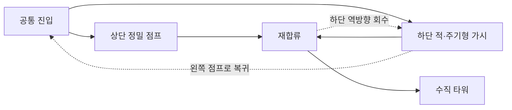

# Campus Runner — Stage 8 최종 맵 전면 재설계

Stage 8을 **계단형 하강 → 상·하단 갈림길 → 수직 상승 타워 → 끊어진 다리 → 졸업 타워**로 교체했다.
월드 너비는 4500, 시작은 (80,360), 깃발은 (4440,480,20,100)이다.
아이템 12개×5점=60점과 기존 GAME_COMPLETE 처리는 유지한다.
최종 목표 난이도는 Stage 7보다 어려운 최상급이며, 체감 난이도·공정성은 GUI 반복 플레이로 최종 확인한다.

## 재설계 전후 차이와 변경 범위

| 항목 | 이전 Stage 8 | 재설계 Stage 8 |
| --- | --- | --- |
| 주 진행 | 수평→수직 발판 연계 반복, 좁은 착지, 가시 4연속 | 하강·실제 갈림길·스위치백 상승·높이가 다른 다리·졸업 계단 |
| 월드 너비 | 4200 | 4500 |
| 고정 지형 | 7개 | 22개 |
| 적 / 고정 가시 / 주기형 가시 | 5 / 6 / 4 | 3 / 3 / 2 |
| 이동 발판 | 수평 2·수직 2 | 타워 수직 1·최종 수평 1 |
| 경로 선택 | 단일 경로 | 상·하단 각각 완주 가능, 합류 후 되돌아가 회수 가능 |
| 아이템 / 점수 | 12개 / 60점 | 12개 / 60점 |

장애물 수를 맞추기 위한 배치는 제거하고 지형과 점프 방식의 차이를 중심으로 만들었다.
Stage 7의 지형 좌표를 옮긴 맵이 아니며, 길게 이어진 수평 바닥 대신 서로 다른 역할의 발판을 사용한다.

이번 재설계에서 수정한 파일은 다음 세 개다.

- `core/src/main/java/io/jbnu/test/StageFactory.java`: createSeniorSemester2() 정의 교체.
- `core/src/test/java/io/jbnu/test/SeniorSemester2Verification.java`: 새 지형·갈림길·반대 방향 회수·카메라 검증으로 교체.
- `docs/SENIOR_SEMESTER2_LEVEL.md`: 이 문서 갱신.

이번 작업 전부터 있던 Stage 8 연결 검증과 미커밋 변경은 보존했다.
Stage 1~7 데이터와 Player, Main, 카메라, GameState, HUD, StageResult,
MovingPlatform, TimedTrap, PatrollingEnemy 코드는 변경하지 않았다.
성적표·GPA·엔딩 분기·새 완료 화면·새 라이브러리·새 게임 기믹 클래스는 추가하지 않았다.

## 물리와 카메라

Player는 32×44, 이동 260, 점프 650, 중력 1700을 유지한다.
연속 물리 기준 최대 상승 약 124.26, 같은 높이 체공 약 0.765초, 이동 약 198.82다.
기존 실제 측정에서 30/60/120fps 최대 상승은 113.67/118.86/121.56,
같은 높이 이동은 190.67/195.00/197.17이다. 모든 필수 경로는 세 FPS에서 검증했다.

기존 카메라는 X만 추적하며 Y 중심은 300, 화면의 월드 높이는 600이다.
새 맵의 발판 윗면은 60~480 안에 있다. 타워 최고 발판 440에서는 점프하지 않고
오른쪽으로 걸어 내려와 윗면 400에 착지한다. 마지막 이동 발판 윗면 420에서 최종 480으로
점프해도 몸체 전체가 화면 높이 600 안에 남는다.

네 정상 경로의 매 프레임에서 다음을 확인했다.

- 플레이어 몸체 전체가 카메라의 X 범위와 Y=0~600 안에 있음.
- 카메라 X 중심이 월드 경계 400~4100 안에 있음.
- Y 중심이 항상 300으로 유지되어 수직 카메라 순간 이동이 없음.
- 도약/하강 전 다음 착지점과 경로상의 현재 적·가시가 카메라 안에 있음.

따라서 이번 맵은 카메라 수정 없이 수직 상승과 하강을 지원한다.
이는 지형·좌표 범위 자동 검증이며, 실제 화면의 HUD 가림·시인성은 GUI에서 확인한다.

## A. 계단형 하강

시작 높이 360에서 280, 200, 120으로 내려간다.
너비 220·180·150·240의 발판과 서로 다른 간격을 사용한다.
첫 하강은 걸어 내려가며, 두 번째 발판의 먼 끝 가시를 점프로 넘고 낮은 발판에 착지한다.
다음 가시도 내려가는 지형을 다 본 뒤 회피한다.
잘못된 위치 x480에 착지하려고 점프하면 실제 빈 공간으로 추락하는 검증도 포함한다.

정상 경로: 시작 → 걸어 내려가 (300,280) → x340에서 점프(560,200)
→ x620에서 점프(800,120) → x840에서 점프(1020,120).

## B. 상단·하단 갈림길과 재합류

x1000~1160의 공통 진입점에서 선택한다.

- **상단**: 윗면 220·280·240의 너비 100·90·100 발판을 정밀 점프로 통과한다.
  (1230,220) → (1390,280) → (1550,240) → 합류 (1730,120).
  선택 아이템 두 개가 상단에 있다.
- **하단**: 높이 60의 통로에서 순찰형 적을 점프로 피하고 주기형 가시를 SAFE에 걷는다.
  (1240,60) → 관찰 x1260 → 적 회피(1450,60) → 대기 x1470
  → SAFE에 x1650까지 통과 → 합류 (1730,120).
  별도 아이템 두 개가 하단에 있다.

두 경로 모두 같은 x1700~1960, 윗면 120의 합류점에 실제로 착지한다.
상단만 또는 하단만 선택하면 10개·50점으로도 최종 완료한다.

전체 수집은 선택 순서와 관계없이 가능하다.

1. **상단 먼저**: 상단을 통과한 뒤 합류점에서 (1640,60)으로 내려간다.
   하단 가시를 SAFE에 왼쪽으로 건너고, 적이 오른쪽으로 접근할 때 왼쪽 점프로 x1260까지 회수한다.
   이후 하단을 오른쪽으로 통과해 다시 합류한다.
2. **하단 먼저**: 하단을 통과한 뒤 같은 반대 방향 회수 경로로 x1260에 돌아온다.
   x1220에서 왼쪽으로 점프해 공통 진입점 (1100,120)에 복귀하고, 상단을 통과해 다시 합류한다.

두 회수 경로 모두 적·함정의 실제 이동을 유지한 채 좌우 입력과 점프만으로 통과했다.
한쪽 선택 때문에 아이템 전체 수집이 불가능해지는 일방통행은 없다.

## C. 수직 상승 타워

합류점에서 첫 작은 발판 (2080,200)에 오른 뒤 수직 발판에 탄다.
승강 발판을 타고 올라가 **왼쪽** 높은 발판으로 내리고, 다시 **오른쪽**의 더 높은 작은 발판으로 점프한다.
최고점 440에서 걸어 내려와 오른쪽 출구 400에 도달한다.
수평→수직 발판 갈아타기를 반복한 이전 Stage 8과 다른 스위치백 구조다.

경로: x1940 → 점프(2080,200) → 발판 끝 x2070
→ 승강 발판이 y≤160일 때 점프해 x2240에 탑승
→ x2200에서 상승 중 y≥310을 기다려 왼쪽 점프(2050,360)
→ x2090에서 오른쪽 점프(2280,440) → 걸어 내려가 (2410,400).

낮은 고정 발판 200에서 왼쪽 높은 발판 360까지는 160 상승이므로 일반 점프로 직접 오를 수 없다.
승강 발판은 윗면 140~340을 오르내린다. 주변 지형·가시와 이동 영역이 겹치지 않고 천장 압착이 없다.

## D. 끊어진 다리

윗면 400의 타워 출구에서 시작해 320 → 360 → 280 → 340 → 260으로 높이가 바뀐다.
너비 160·140·160·90·180, 간격 90·60·100·60·80을 사용해 동일 간격의 반복을 피했다.
아래에 긴 안전 바닥은 없고, 틈에 착지하면 실제로 추락한다.

첫 섬과 마지막 섬에는 별도 적이 있고, 중간 섬에는 주기형 가시와 고정 가시가 있다.
적을 피하는 점프 후 짧은 섬 끝에서 다음 점프를 준비해야 한다.

경로: 점프(2620,320) → 적이 돌아올 때 점프(2740,320)
→ 점프(2840,360) → 주기형 SAFE에 x2950까지 통과
→ 점프(3100,280) → 고정 가시를 넘으며 점프(3290,340)
→ 점프(3470,260) → 적이 돌아올 때 점프(3600,260).

## E. 마지막 졸업 타워

다리 끝에서 320, 400 높이의 작은 계단을 오른다.
마지막 수평 이동 발판을 타고 높은 최종 480 착지면으로 점프한다.
발판 없이 높이 400의 고정 계단 끝 x4030에서 다음 고정 지형 x4300까지 바로 점프할 수 없다.
깃발은 넓은 최종 착지면 끝부분에 있으며 주변에 즉사 함정을 두지 않았다.

경로: 점프(3760,320) → x3820 → 점프(3960,400) → x3980에서 이동 발판 관찰
→ 발판 x≤4080에서 점프해 x4110에 탑승
→ 오른쪽 이동 중 x≥4120에서 앞쪽으로 걷고 점프(4340,480) → 깃발 x4440.

## 모든 고정 발판 좌표

왼쪽 아래 기준 `(x,y,너비,높이)`이며, 윗면은 y+높이다.

| 번호 | 구간·역할 | 좌표 | 윗면 |
| --- | --- | --- | ---: |
| 1 | A 시작 | (0,340,220,20) | 360 |
| 2 | A 하강·가시 | (280,260,180,20) | 280 |
| 3 | A 하강 | (540,180,150,20) | 200 |
| 4 | A 하강·가시 | (760,100,240,20) | 120 |
| 5 | B 공통 진입 | (1000,100,160,20) | 120 |
| 6 | B 상단 1 | (1200,200,100,20) | 220 |
| 7 | B 상단 2 | (1370,260,90,20) | 280 |
| 8 | B 상단 3 | (1530,220,100,20) | 240 |
| 9 | B 하단 통로 | (1200,40,480,20) | 60 |
| 10 | B 재합류 | (1700,100,260,20) | 120 |
| 11 | C 진입 발판 | (2000,180,100,20) | 200 |
| 12 | C 왼쪽 높은 발판 | (2010,340,100,20) | 360 |
| 13 | C 오른쪽 최고점 | (2240,420,100,20) | 440 |
| 14 | C 출구 | (2370,380,140,20) | 400 |
| 15 | D 첫 적의 섬 | (2600,300,160,20) | 320 |
| 16 | D 주기형 섬 | (2820,340,140,20) | 360 |
| 17 | D 고정 가시 섬 | (3060,260,160,20) | 280 |
| 18 | D 좁은 섬 | (3280,320,90,20) | 340 |
| 19 | D 마지막 적의 섬 | (3450,240,180,20) | 260 |
| 20 | E 첫 계단 | (3740,300,140,20) | 320 |
| 21 | E 둘째 계단 | (3930,380,100,20) | 400 |
| 22 | E 최종 착지면 | (4300,460,200,20) | 480 |

## 적·가시·이동 발판

순찰 범위는 적 몸체 왼쪽 기준이다. 세 적 모두 몸체 전체가 고정 지형 위에 남는다.

| 적 | 초기 위치 | 크기 | 순찰 X | 속도 | 초기 방향 |
| --- | --- | --- | --- | ---: | --- |
| 하단 경로 | (1370,60) | 28×32 | 1320~1420 | 85/초 | 오른쪽 |
| 첫 다리 섬 | (2690,320) | 28×32 | 2670~2700 | 90/초 | 왼쪽 |
| 마지막 다리 섬 | (3550,260) | 30×32 | 3520~3580 | 95/초 | 왼쪽 |

| 함정 | 좌표 (x,y,너비,높이) | 주기·오프셋 |
| --- | --- | --- |
| A 고정 가시 | (400,280,40,24) | 항상 ACTIVE |
| A 고정 가시 | (900,120,40,24) | 항상 ACTIVE |
| D 고정 가시 | (3170,280,40,24) | 항상 ACTIVE |
| B 하단 주기형 | (1530,60,96,48) | SAFE 1.3 / WARNING 0.7 / ACTIVE 1.8초, 오프셋 0 |
| D 다리 주기형 | (2890,360,56,48) | SAFE 1.1 / WARNING 0.7 / ACTIVE 1.6초, 오프셋 1초 |

기존 삼각형 충돌·렌더링과 회색/노랑/빨강 상태색을 사용한다.
하단 경로 주기형은 왼쪽과 오른쪽 두 방향 모두 실제 SAFE 통과를 검증했다.
두 함정의 몸체 포함 통과 시간은 각각 약 0.492초·0.338초로 SAFE 시간 안에 여유가 있다.

| 발판 | 시작 ↔ 끝 | 크기 | 속도 | 편도 / 왕복 |
| --- | --- | --- | ---: | --- |
| C 승강 발판 | (2190,120) ↔ (2190,320) | 120×20 | 65/초 | 약 3.08초 / 6.15초 |
| E 이동 다리 | (4060,400) ↔ (4140,400) | 120×20 | 65/초 | 약 1.23초 / 2.46초 |

## 아이템 12개 좌표

모두 24×24, 각 5점이다. 고정 지형·가시 외곽과 겹치지 않는다.

| 번호 | 좌표 (x,y) | 위치 |
| --- | --- | --- |
| 1 | (140,384) | A 시작 |
| 2 | (570,224) | A 하강 발판 |
| 3 | (1230,244) | B 상단 선택 경로 |
| 4 | (1390,304) | B 상단 정밀 점프 |
| 5 | (1260,84) | B 하단 적 관찰 지점 |
| 6 | (1640,84) | B 하단 함정 뒤 |
| 7 | (2080,224) | C 첫 상승 발판 |
| 8 | (2280,464) | C 최고점 |
| 9 | (2740,344) | D 첫 적 회피 뒤 |
| 10 | (3290,364) | D 좁은 섬 |
| 11 | (3800,344) | E 첫 계단 |
| 12 | (4380,504) | E 최종 착지면 |

분기 두 곳을 모두 통과하면 12개·60점, 한쪽 분기만 선택하면 10개·50점이다.
두 선택 모두 GAME_COMPLETE에 도달한다. 아이템 전체 개수와 점수 저장·HUD 구조는 변경하지 않았다.

## 자동 검증 결과

SeniorSemester2Verification은 정상 로딩과 실제 LEFT/RIGHT·SPACE·ENTER·ESC 입력만 사용한다.
플레이어 좌표·속도, 적·함정·발판 위상, 아이템 상태를 직접 변경하지 않는다.
기존 Freshman의 별도 직접 배치 생명주기 검사는 유지하지만 새 맵 경로 검증은 이에 의존하지 않는다.

| FPS | 상단 먼저·전체 12개/60점·안정성 추가 | 상단만 10개/50점 | 하단만 10개/50점 | 하단 먼저·전체 12개/60점 |
| --- | --- | --- | --- | --- |
| 30 | 48.43초 | 31.53초 | 31.53초 | 34.00초 |
| 60 | 47.37초 | 31.53초 | 31.53초 | 34.00초 |
| 120 | 46.85초 | 31.55초 | 31.55초 | 34.01초 |

첫 전체 경로에는 승강 발판 8초·최종 발판 4초 무입력 탑승과 일시정지 검사가 추가된다.
시간은 자동 입력의 관찰 대기를 포함하며 사람의 체감 난이도·반응·실패 시간을 의미하지 않는다.

세 FPS에서 다음을 통과했다.

- 계단형 하강, 상단·하단 각각의 실제 통과와 동일 지점 재합류.
- 상단 먼저/하단 먼저 두 선택 순서 모두 반대 방향 회수·되돌아가기와 12개·60점 기록.
- 상단만/하단만 선택한 두 부분 수집 경로의 10개·50점 기록과 완료.
- 수직 타워의 상승·왼쪽 하차·오른쪽 높은 발판 점프·출구로 걸어 하강.
- 높이·간격·너비가 다른 끊어진 다리와 두 적·함정·고정 가시 처리.
- 졸업 계단과 이동 발판, 높이 480의 마지막 착지면·깃발 도달.
- 정상 네 경로 전체의 프레임별 플레이어 화면 유지, 카메라 월드 범위와 고정 Y, 도약 전 착지점·위험 요소 시야.
- 실제 하강 점프의 잘못된 착지로 추락 → GAME_OVER → Enter 재시작 → 전체 경로 재완주.
- 적 세 마리, 고정 가시 세 곳, 활성 주기형 두 곳 각각 실제 접촉 실패.
- 두 주기형의 순서·시간 범위·반복 전환과 실제 SAFE 무피해 통과, 하단 함정의 양방향 통과.
- 승강 발판과 이동 다리 양 끝점 방향 전환 중 탑승 안정성.
- ESC 정지·재개와 적·함정·발판 정지, 재시작 시 아이템 12개·0점·높은 시작 위치·적 방향·함정 위상·발판 위치 복원.
- Stage 1~7 실제 결과 20/25/30/35/40/45/50점의 실패·재시작·완료 후 보존.
- Stage 8 60점 저장·총점 305점, GAME_COMPLETE 유지와 Stage 9 거부.
- 완료 화면 Enter가 기존 새 게임으로 Stage 1을 로드하며 결과를 초기화함.
- 기존 Stage 1~7 실제 입력 경로와 8학기 생명주기 회귀 검사.

JDK 17에서 `.\gradlew.bat build` 성공. Java 8 소스 호환성과 LibGDX 1.13.1 설정을 유지했다.
최종 미해결 실패는 없으며 검증 완화·강제 성공·순간 이동을 사용하지 않았다.
기존 물리·장애물·카메라 코드를 바꾸어 통과시키지 않았다.

## GUI 수동 테스트 항목 (미실행)

`.\gradlew.bat lwjgl3:run`으로 Stage 1~7을 클리어하고 새 Stage 8에 진입한다.

- 시작부터 내려가는 지형과 가시 위치, 아래 착지면이 명확하게 보이는지 확인.
- 상단·하단 선택이 실제로 구분되고 재합류·되돌아갈 수 있는 경로가 직관적인지 확인.
- 양쪽 선택에서 선택 아이템을 회수한 뒤 정상 진행이 가능하고, 한쪽만으로도 완료되는지 확인.
- 수직 타워의 승강 발판·왼쪽 높은 발판·오른쪽 최고점·걸어 내려가는 출구의 시야와 방향감 확인.
- 끊어진 다리의 서로 다른 폭·높이·간격과 좁은 섬의 준비 공간, 적·주기형 가시의 관찰 여유 확인.
- 마지막 계단·이동 다리·높은 깃발이 졸업 목적지로 잘 보이는지 확인.
- 카메라 밖으로 몸체가 나가지 않고 아래·위 착지면과 HUD가 겹쳐 읽기 어려워지지 않는지 확인.
- 가시의 실제 삼각형 접촉, 상태색·경고 시인성, 적 방향, 발판 방향 전환의 떨림·끼임 여부 확인.
- ITEMS 12 / 12·SCORE 60, 부분 수집 완료, GAME_COMPLETE·총점, 재시작·일시정지·새 게임 처리 확인.
- Stage 7보다 더 어려운지, 하강·경로 선택·수직 스위치백·다리·졸업 계단이 서로 다르게 느껴지는지 반복 플레이로 확인.

Git commit, push, merge는 실행하지 않았다.
