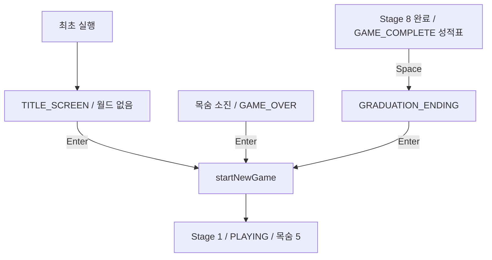

# Campus Runner — 메인 시작 화면

## 시작 화면 구조

처음 실행하면 `Main`의 초기 상태는 `TITLE_SCREEN`이다.
`create()`는 기존 그래픽 리소스·월드 카메라·UI 카메라·viewport만 준비하고,
`startNewGame()`을 호출하지 않는다. Enter 전에는 StageDefinition·플레이어·아이템·적·가시·이동 발판을
생성하지 않으므로 게임 월드와 물리가 진행될 수 없다.

`render()`는 기존 `update()`를 호출한 뒤 TITLE_SCREEN이면 `renderTitleScreen()`만 실행하고 반환한다.
월드 렌더링, 플레이 HUD, 성적표, 엔딩 렌더링은 시작 화면과 분리되어 있다.

표시 내용:

- CAMPUS RUNNER
- 8 SEMESTERS TO GRADUATION
- Collect credits. Survive semesters. Graduate!
- LEFT / RIGHT ARROWS - MOVE
- SPACE - JUMP
- ESC - PAUSE / RESUME
- PRESS ENTER TO START

이동·점프 키는 `Player.update()`의 LEFT/RIGHT·SPACE, 일시정지 키는 `Main.update()`의 ESCAPE를 확인했다.
기존 조작키를 바꾸지 않았다.

## Enter 입력과 기존 재시작

TITLE_SCREEN은 Enter의 `isKeyJustPressed`만 확인한다. Enter가 없으면 다른 키를 무시하고 즉시 반환한다.
Enter가 있으면 기존 `startNewGame()`으로 초기화한 후에도 즉시 반환하므로,
같은 프레임에 누른 화살표·Space·ESC를 새 월드에 적용하지 않는다.
다음 갱신부터는 PLAYING의 기존 입력 처리를 사용한다. Enter를 누른 채 유지하거나
PLAYING에서 다시 눌러도 초기화 분기에 진입하지 않는다.

TITLE_SCREEN을 설정하는 경로는 최초 상태 선언뿐이다.
GAME_OVER Enter와 졸업 엔딩 Enter는 기존처럼 바로 Stage 1을 시작하며 타이틀로 돌아가지 않는다.
성적표 Enter 무시·Space로 엔딩 전환하는 규칙도 유지한다.

공통 초기화는 모든 StageResult·학기 점수·보너스·학기 사망 기록·전체 누적 사망을 삭제한다.
전체 점수는 비워진 결과의 합계인 0이 된다. Stage 1 원본으로 런타임을 새로 만들고,
현재 아이템 점수·수집 개수·학기 사망 0, 목숨 5, PLAYING으로 전환한다.

## UI 렌더링

기존 800×600 UI FitViewport와 고정된 uiCamera를 사용한다.
월드 카메라 위치나 플레이어 좌표를 사용하지 않으며, 창 크기 변경 시 같은 UI 비율을 유지한다.
가로세로 비율이 다른 창에서는 FitViewport의 여백으로 전체 내용을 보존한다.

어두운 남색 배경에 금색 제목과 졸업모, 밝은 설명·시작 안내를 배치했다.
중앙 조작 안내 패널과 하단 양쪽 캠퍼스 건물 실루엣은 ShapeRenderer로 그린다.
기존 BitmapFont와 SpriteBatch를 그대로 사용한다. 시작 화면은 영문이므로
추가 한글 글리프나 새 이미지·라이브러리가 필요 없다.
렌더링 후 폰트 크기와 색상을 기존 HUD 설정(2배, 검정)으로 되돌린다.
점멸·시간 효과는 추가하지 않아 프레임레이트에 따른 화면 차이가 없다.

## 자동 검증

`TitleScreenVerification`을 기존 `FreshmanLevelVerification` 실행 체인에 연결했다.
`.\gradlew.bat build` 성공 (JDK 17 실행, Java 8 소스 호환 유지).

| 검증 | 30fps | 60fps | 120fps |
| --- | --- | --- | --- |
| 최초 TITLE_SCREEN·Enter 전 3초 동안 월드 미생성 | 통과 | 통과 | 통과 |
| 화살표·Space·ESC로 시작/물리/장애물 갱신 불가 | 통과 | 통과 | 통과 |
| Enter+다른 키 동시 입력 시 정확한 Stage 1 초기 위치 | 통과 | 통과 | 통과 |
| 시작 직후 목숨 5·아이템 점수/수집/학기 사망/누적 사망 0 | 통과 | 통과 | 통과 |
| 시작 직후 모든 결과·보너스·학기 사망 기록 비어 있음 | 통과 | 통과 | 통과 |
| Enter 유지 2초 동안 동일 런타임 유지 | 통과 | 통과 | 통과 |
| 아이템 획득 후 반복 Enter에도 점수/런타임 유지 | 통과 | 통과 | 통과 |
| Stage 4의 다섯 사망 후 GAME_OVER Enter로 바로 Stage 1 | 통과 | 통과 | 통과 |
| 성적표 → Space → 엔딩 → Enter로 바로 Stage 1 (기존 검증) | 통과 | 통과 | 통과 |
| 목숨·사망·생존 보너스·GPA·다섯 엔딩 회귀 | 통과 | 통과 | 통과 |
| Stage 1~8 실제 이동/점프·수집·충돌 경로 회귀 | 통과 | 통과 | 통과 |

시작 화면 테스트는 플레이어와 장애물 참조가 없는 상태로 업데이트를 실행하므로
Enter 전 월드 진행이 발생하지 않음을 확인한다. 아이템 획득·GAME_OVER 확인에는
기존 생명주기 검증과 같은 위치 픽스처로 실제 수집·사망 처리를 실행한다.
맵 진행 가능 여부는 기존 실제 입력 경로 검증을 그대로 유지한다.

## 실제 GUI 확인

LWJGL3 창에서 실제 `Main.create()`·`render()`를 실행했다.
임시 검증 도구(`build/title-gui/TitleGuiSmoke.java`, Git 제외)는 시작 화면 상태와 월드 미생성을 확인하고,
창 크기를 변경해 프레임버퍼를 캡처했다. 이어 한 프레임의 Enter 입력을 주입하여
PLAYING 진입을 검증하고 Stage 1 화면도 캡처한 뒤 자동 종료했다.
초기 GUI 검증 도구는 LWJGL이 매 프레임 Gdx.input을 설정하는 순서 때문에 주입이 적용되지 않았으며,
검증 도구에서 렌더 직전에 입력을 주입하도록 수정한 후 통과했다. 제품 입력 코드는 바꾸지 않았다.

| GUI 항목 | 결과 |
| --- | --- |
| 640×480 (기존 데스크톱 기본 크기) | 제목·조작법·시작 안내 잘림/겹침 없음 |
| 800×600 | 중앙 정렬·졸업모·안내 패널 정상 |
| 1280×720 | FitViewport 비율·좌우 여백·전체 안내 정상 |
| Enter 주입 후 Stage 1 | YEAR 1·SEMESTER 1·LIVES 5/5·ITEMS 0/4·SCORE 0 확인 |

현재 워크스페이스의 캡처:

- [640×480 시작 화면](../build/title-gui/title-640x480.png)
- [800×600 시작 화면](../build/title-gui/title-800x600.png)
- [1280×720 시작 화면](../build/title-gui/title-1280x720.png)
- [Enter 이후 Stage 1](../build/title-gui/stage1-after-enter.png)

캡처와 임시 도구는 build 디렉터리에 있어 Git에 포함되지 않는다.
물리 키보드를 이용한 수동 플레이는 수행하지 않았다. 직접 확인할 항목:

- 실제 Enter를 길게 누르거나 Space/ESC와 동시에 눌러도 한 번만 시작되는지 확인.
- Stage 1에서 좌우 화살표·Space·ESC가 안내대로 동작하는지 확인.
- 창을 매우 작게 줄이거나 최대화했을 때도 안내를 읽을 수 있는지 확인.
- GAME_OVER와 졸업 엔딩의 Enter가 시작 화면 없이 Stage 1로 직접 돌아가는지 확인.

## 변경 파일과 범위

- `core/src/main/java/io/jbnu/test/Main.java`: 초기 TITLE_SCREEN·별도 렌더링·Enter 처리.
- `core/src/main/java/io/jbnu/test/GameState.java`: TITLE_SCREEN 추가.
- `core/src/test/java/io/jbnu/test/TitleScreenVerification.java`: 시작 상태와 입력·초기화 검증 추가.
- `core/src/test/java/io/jbnu/test/FreshmanLevelVerification.java`: 새 검증 호출 추가.
- `docs/TITLE_SCREEN.md`: 구조와 검증 기록.

Stage 1~8 맵·Player 물리·조작키·장애물·목숨·보너스·GPA·성적표 내용·엔딩 기준은 유지했다.
Git commit·push·merge는 실행하지 않는다.
