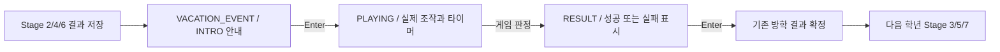

# Campus Runner — 실제 방학 미니게임 3종 (STEP 9-2 / STEP 9-3)

STEP 9-1의 임시 S/F 결과 선택을 제거하고 실제 입력·시간 제한·점수/퍼즐 판정으로 교체했다.
방학 결과와 PlayerModifier 규칙은 [VACATION_SYSTEM.md](VACATION_SYSTEM.md)를 유지한다.

## 공통 진행과 책임



`VacationMinigame`는 그래픽과 분리된 공통 모델로 INTRO / PLAYING / RESULT와 타이머·결과를 관리한다.
`CafeMinigame`, `CertificationMinigame`, `HackathonMinigame`는 각자 고유한 규칙을 구현한다.
`MinigameInput`은 한 프레임의 좌우 유지 입력과 새 키 입력을 구분한 불변 스냅샷이다.
`VacationMinigameRenderer`만 기존 ShapeRenderer·SpriteBatch·BitmapFont로 화면을 그린다.
Main은 이벤트 생성, 입력 전달, 결과 확인 및 기존 방학 완료 API 호출만 담당한다.

깃발 도착 프레임의 Enter로 안내를 생략하지 않는다. 안내 Enter는 게임만 시작하며 타이머나
제출로 이어지지 않는다. PLAYING에서 결과가 나온 프레임에는 다음 학년으로 이동하지 않는다.
결과 화면에서 새 Enter가 있어야 보상을 확정하고 다음 학기를 로드한다.
그 프레임의 화살표·Space·Enter는 새 플랫포머에 다시 적용하지 않는다.

VACATION_EVENT 전체에서 기존 플레이어·중력·아이템·가시·적·이동 발판은 정지한다.
S/F는 게임 시작·종료·성공/실패 선택에 사용하지 않는다. ESC로 플랫포머를 재개하지 않는다.
입력은 기존 `isKeyJustPressed`로 수집하므로 키 유지로 여러 답이나 제출을 연속 처리하지 않는다.
메모리 게임에서 여러 방향을 동시에 누르면 답을 처리하지 않는다.
서버 게임의 Space와 Enter 동시 입력은 Space 회전 하나만 처리한다.

## A. 카페 아르바이트 (Stage 2 이후)

- 조작: 좌우 화살표로 받침대 이동.
- 제한 시간: 30초. 종료 시 **100점 이상 성공**, 미만 실패.
- 커피 컵 수집 +10, 회색 마름모 쓰레기 수집 -10, 점수 하한 0.
- 놓친 커피는 점수를 바꾸지 않는다.
- 100점을 먼저 넘겨도 30초가 끝날 때까지 플레이한다. 이후 쓰레기를 받아 목표 아래로 내려갈 수도 있다.

크림색 배경·갈색 받침대와 주황/갈색 컵을 사용한다. 쓰레기는 회색 마름모로 색과 모양 모두 구별한다.
HUD는 SCORE·TIME·TARGET이며, 이 SCORE는 미니게임 전용으로 학기 아이템 점수가 아니다.

받침대 폭은 110, 속도는 초당 500 UI 단위다. 낙하물은 0.35초 후부터 0.72초 간격으로 생성한다.
네 물체 중 세 개가 커피이며 X 좌표는 무작위다. 커피 속도는 155, 쓰레기는 175다.
시작 Y=440으로 HUD 아래에서 생성하고, 받침대 Y=70에 도달하기 전 이동할 시간을 준다.
정상적으로 목표를 달성할 충분한 커피를 생성하며, 잡거나 화면 아래를 벗어난 물체는 즉시 제거한다.
받침대와 겹치는 접촉 및 한 프레임에 윗면을 통과하는 접촉을 검사해 옆으로 들어온 컵과 빠른 낙하도 처리한다.

성공: Stage 3·4 시작 목숨 6개. 실패: Stage 3·4 이동 속도 0.95배.

## B. 자격증 공부 (Stage 4 이후)

- 조작: 위·아래·왼쪽·오른쪽 방향키를 순서대로 한 번씩 누른다.
- 전체 제한 시간 40초, 패턴 길이는 **2, 3, 3, 4, 5**인 총 5라운드.
- 패턴을 `2.0 + 길이 × 0.25`초(2.5~3.25초) 동안 보여준 뒤 숨긴다.
- 표시 중 입력은 무시하며, 표시가 끝나는 갱신에서도 답을 처리하지 않는다.
- 정답 순서를 완성하면 다음 라운드. 오답은 실수 +1 후 같은 패턴을 처음부터 다시 보여준다.
- 5라운드 완료 시 즉시 성공. 시간 초과 또는 실수 3회면 실패.

차분한 파란색 배경·녹색 방향 화살표를 사용한다. 화살표는 ShapeRenderer로 그려 폰트 글리프에 의존하지 않는다.
ROUND·TIME·MISTAKES, 표시/입력 단계와 정답 입력 개수를 보여준다.
숨긴 동안 모델도 외부에 패턴을 제공하지 않고, 화면은 물음표 카드로 바꾼다.

성공: Stage 5·6 점프력 1.10배. 실패: Stage 5·6 점프력 0.95배.

## C. SERVER CONNECTION — 서버 연결하기 (Stage 6 이후)

- 조작: 네 방향키로 커서 이동, Space로 현재 회로를 시계 방향 90도 회전, Enter로 연결 검사.
- 커서는 격자 안에서만 움직인다. 빈 타일·시작 컴퓨터·서버는 회전하지 않는다.
- 전체 제한 시간 45초, 총 3개 회로 퍼즐. 퍼즐 사이에 시간과 실수 횟수는 유지한다.
- Enter 검사 시 PC에서 서버까지 연결되면 다음 퍼즐, 잘못된 연결이면 실수 +1.
- 3개 완료 시 즉시 성공. 시간 초과 또는 실수 3회면 실패.
- 판정은 회전 배열 비교가 아니라 양방향 포트가 맞물리는 실제 회로의 BFS 탐색이다.

### 타일과 연결 판정

`CircuitTile`은 EMPTY·STRAIGHT·ELBOW·START·SERVER 종류와 0~3의 회전값을 가진 불변 객체다.
포트는 UP=1, RIGHT=2, DOWN=4, LEFT=8 비트다. 직선은 상하/좌우, 꺾임은 인접 두 방향을 연결한다.
컴퓨터와 서버는 고정된 한 방향 포트를 가지며, 이 퍼즐의 컴퓨터는 오른쪽, 서버는 왼쪽을 향한다.
렌더러는 같은 `getPorts()`를 읽어 회로를 그리므로 보이는 모양과 판정 데이터가 일치한다.

`CircuitBoard`는 타일 행 배열을 복사해 보관하며, `trace()`는 다음과 같이 검사한다.

1. 시작 컴퓨터를 큐에 넣고 방문 표시한다.
2. 현재 타일의 열린 방향으로 인접 칸을 찾는다.
3. 인접 타일에 반대 방향 포트가 있을 때만 이동한다.
4. 이미 방문한 칸은 다시 큐에 넣지 않는다.
5. 서버에 도달하고 시작점에서 통하는 회로에 격자 밖/한쪽만 열린 연결이 없으면 성공이다.

시작점과 무관한 타일이나 닫힌 순환 회로는 정답에 포함할 필요가 없다.
틀린 서버 방향·끊긴 중간 타일·상대 포트 없는 접촉·신호가 격자 밖으로 나가는 연결은 실패한다.
정답으로 설계한 경로와 다른 길도 실제로 서버에 도달하면 성공이다.
동일한 포트가 되는 직선의 180도 차이나 무관한 타일 방향도 성공을 방해하지 않는다.
플레이 중 검사는 Enter에서만 실행한다. 마지막 검사에서 시작점과 통했던 회로를 연두색으로 표시하며,
타일 회전 후에는 그 검사 표시를 지워 오래된 결과를 보여주지 않는다.

### 세 퍼즐의 구성

`CircuitPuzzles`는 먼저 연결 가능한 완성 보드를 만든 다음 회전 가능한 타일만 무작위로 회전시킨다.
초기 배치가 우연히 연결되어 있으면 시작 경로의 타일을 더 회전시켜 반드시 한 번 이상 조작하게 한다.
타일 위치나 종류를 무작위로 바꾸지 않아 항상 Space 회전만으로 풀 수 있다.
아래 좌표는 0부터 시작하는 (행, 열)이며, 행은 위에서 아래로 증가한다.

| 퍼즐 | 격자 | 시작 → 서버 | 설계 |
| --- | --- | --- | --- |
| 1 | 4×4 | (0,0) → (2,3) | 직선과 두 꺾임으로 기본 연결 학습 |
| 2 | 5×5 | (2,0) → (0,4) | 아래쪽으로 돌아 올라가는 여러 꺾임과 방해 회로 |
| 3 | 6×6 | (4,0) → (1,5) | 위/아래 후보 경로, 합류 지점, 시작점과 무관한 순환 회로 |

완성 기준 경로:

```text
1: (0,0) → (0,1) → (0,2) → (1,2) → (2,2) → (2,3)
2: (2,0) → (2,1) → (3,1) → (3,2) → (3,3) → (2,3)
   → (1,3) → (1,2) → (0,2) → (0,3) → (0,4)
3: (4,0) → (4,1) → (3,1) → (2,1) → (2,2) → (2,3)
   → (3,3) → (3,4) → (2,4) → (1,4) → (1,5)
3의 다른 유효 경로:
   (4,0) → (4,1) → (5,1) → (5,2) → (5,3) → (4,3)
   → (3,3) → (3,4) → (2,4) → (1,4) → (1,5)
```

세 번째 퍼즐은 상단 또는 하단으로 우회해 합류하는 경로 선택 구조다.
동시에 세 방향을 여는 T자 타일을 추가하지 않고, 직선/꺾임 회전만으로 후보 경로를 선택한다.
설계 경로는 보드 생성에만 사용하며 성공 판정 코드에서는 비교하지 않는다.

어두운 남색 배경, 청록 회로, 밝은 파란 컴퓨터와 금색 서버, 밝은 테두리 커서를 사용한다.
상단은 SERVER CONNECTION·PUZZLE·TIME·MISTAKES, 하단은 ARROWS: MOVE / SPACE: ROTATE / ENTER: CHECK다.
격자에 맞춰 칸 크기를 68/60/50 UI 단위로 조절한다.
성공: Stage 7·8 이동 속도 1.10배. 실패: Stage 7·8 이동 속도 0.95배.

## 타이머·결과·효과 보존

안내 및 결과 화면에서는 타이머가 흐르지 않는다. PLAYING에서만 delta를 사용하며,
마지막 갱신은 남은 시간까지로 제한한다. 판정된 결과는 한 번만 저장하고 그 뒤 모델 갱신은 무시한다.
자격증/해커톤의 마지막 유효 갱신에서 정답을 완성하면 성공하고, 그렇지 않고 제한 시간에 도달하면 실패한다.
인스턴스는 이벤트마다 새로 만들고 전체 재시작에서도 제거하므로 이전 라운드·물체·타이머가 남지 않는다.

Main의 `completeVacationEvent(type, success)`는 실제 게임이 RESULT 상태이고,
종류와 판정 결과가 인자와 일치할 때만 기존 VacationManager로 전달한다.
조기 호출·다른 성공 여부·중복 호출·오래된 종류의 콜백을 거부한다.
기존 모델을 통한 불변 효과 교체, 두 학기 지속, 학년 전환 시 종료, 학기 내 사망 시 유지 규칙은 그대로다.
GAME_OVER와 졸업 엔딩 Enter는 모든 방학 기록과 현재 미니게임을 함께 초기화한다.

미니게임 실패는 현재 목숨이나 학기 점수를 차감하지 않는다.
커피 점수·실수 횟수·퍼즐 개수는 StageResult/GPA에 들어가지 않는다.
아이템 최대 305 + 보너스 최대 160 = **465점**, GPA 최대 **4.50**, 5종 엔딩 기준을 유지한다.

## 자동 검증

`.\gradlew.bat build` 성공 (JDK 17 실행, Java 8 소스 호환 유지).
`VacationMinigamesVerification`과 `ServerConnectionVerification`을 기존 Gradle 실행 체인에 연결했다.

| 항목 | 30fps | 60fps | 120fps |
| --- | --- | --- | --- |
| 카페 커피 +10·쓰레기 -10·0점 하한·옆으로 이동한 접촉 | 통과 | 통과 | 통과 |
| 놓친 커피 무점수·수집/화면 밖 물체 제거 | 통과 | 통과 | 통과 |
| 100점 조기 종료 방지·정확히 100점 성공·0점 실패·30초 종료 | 통과 | 통과 | 통과 |
| 카페 무작위 배치 30개 seed에서 성공/실패 입력 재생 | 통과 | 통과 | 통과 |
| 자격증 패턴 표시 중 입력 무시·숨긴 패턴 비공개 | 통과 | 통과 | 통과 |
| 정답 순서·5라운드 성공·오답 재시도·3실수 실패·40초 제한 | 통과 | 통과 | 통과 |
| 서버 퍼즐의 직선/꺾임 90도 회전·고정/빈 칸 회전 불가·커서 경계 | 통과 | 통과 | 통과 |
| 실제 양방향 연결 BFS·단절/일방향/서버 방향/격자 밖 실패 | 통과 | 통과 | 통과 |
| 기준과 다른 하단 경로·무관한 타일·순환 회로·회전값 동등성 | 통과 | 통과 | 통과 |
| 100개 seed 및 항상 0을 반환하는 난수에서도 세 보드 입력으로 해결 | 통과 | 통과 | 통과 |
| 3퍼즐 성공·3실수 실패·45초 제한 | 통과 | 통과 | 통과 |
| 방향/Space/Enter 유지와 동시 입력 중복 처리 방지 | 통과 | 통과 | 통과 |
| Main 입력으로 세 게임 각각 성공/실패·결과 Enter 전 보상 대기 | 통과 | 통과 | 통과 |
| 안내/결과 입력 분리·S/F 제거·결과와 다른 콜백 거부 | 통과 | 통과 | 통과 |
| 미니게임 전체 동안 플랫포머·아이템·목숨·사망 기록 정지 | 통과 | 통과 | 통과 |
| 다음 학년 효과·두 학기 지속/종료·전체 재시작 초기화 | 통과 | 통과 | 통과 |
| Stage 1~8 실제 이동/점프·충돌·수집 회귀 | 통과 | 통과 | 통과 |
| 기존 목숨·시작 화면·성적표·465점/GPA 4.50·5종 엔딩 회귀 | 통과 | 통과 | 통과 |

테스트 플레이어 `MinigameTestDriver`는 떨어지는 물체 위치를 보고 움직이고,
보여준 패턴을 기억해 방향키로 답하며, 서버 퍼즐의 실제 타일을 Space로 회전해 Enter로 검사한다.
게임 점수·퍼즐 순서·타이머·성공 여부를 직접 수정하지 않는다.
기존 학기 전환 회귀에서도 완료 결과를 주입하는 대신 이 입력 재생으로 실제 게임을 끝낸다.
전용 통합 검증은 Gdx.input 스냅샷 → Main.update → 결과 Enter까지 실제 경로를 실행한다.
기존 맵 검증의 아이템·충돌·점수·보너스 조건은 완화하지 않았다.
서버 전용 검증은 100개 seed의 세 퍼즐을 각 fps에서 실제 키 입력으로 해결한다.
잘못된 검사 후에도 다음 퍼즐에 실수 횟수와 남은 시간이 유지되는지 확인하며,
세 번째에서는 기준과 다른 하단 경로를 입력으로 완성하고 성공으로 판정되는지 검사한다.

30개 seed 검증은 자동 입력으로 성공이 가능한지 확인하는 회귀 검사이며,
사람이 느끼는 난이도를 모두 보장하는 수동 플레이 검증은 아니다.

## GUI 검증과 남은 수동 확인

STEP 9-2에서 세 게임의 화면 27개를 캡처했다.
STEP 9-3에서는 실제 LWJGL 창에서 서버 연결의 **안내·세 보드·검사 강조·결과 × 세 해상도 = 18개**를 새로 캡처했다.
시작 화면을 먼저 렌더링한 뒤 Stage 6 이벤트를 실행하는 임시 GUI 도구로 확인했다.
기존 UI FitViewport와 폰트를 재사용하며, 중앙 정렬은 BitmapFont 내장 정렬을 사용한다.
카페 낙하물의 생성 높이를 HUD 아래로 조정하고, 작은 창의 제목 표시도 확인했다.
새 이미지·폰트·외부 라이브러리는 추가하지 않았다.

현재 워크스페이스의 예시 캡처 (build 아래 생성물이며 Git 제외):

- [카페 플레이 640×480](../build/minigame-gui/cafe-playing-640x480.png)
- [자격증 플레이 800×600](../build/minigame-gui/certification-playing-800x600.png)
- [서버 퍼즐 1 — 800×600](../build/server-gui/puzzle1-800x600.png)
- [서버 퍼즐 3 — 640×480](../build/server-gui/puzzle3-640x480.png)
- [서버 안내 — 640×480](../build/server-gui/intro-640x480.png)
- [서버 검사 강조 — 1280×720](../build/server-gui/checked-1280x720.png)
- [카페 결과 640×480](../build/minigame-gui/cafe-result-640x480.png)

임시 GUI 검증 도구는 실제 Main 리소스와 렌더링을 사용하고 입력 재생으로 성공 결과를 만든다.
물리 키보드로 직접 플레이하는 확인은 수행하지 않았다. 남은 수동 확인 항목:

- 카페에서 컵/쓰레기 구별과 받침대 움직임이 자연스러운지, 30초 동안 100점이 적절한 난이도인지 확인.
- 자격증 표시 시간이 충분한지, 패턴을 숨긴 뒤 키 유지가 반복 답변으로 처리되지 않는지 확인.
- 서버 퍼즐의 커서, 직선/꺾임 방향, 고정 컴퓨터/서버 포트와 검사한 경로 강조를 확인.
- 세 회로를 45초 안에 해결하는 난이도와 하단 대체 경로를 직접 플레이해 확인.
- 안내 Enter, 마지막 제출 Enter, 결과 Enter를 누른 채로 화면이 연속 생략되지 않는지 확인.
- 실패 결과 뒤 다음 학년에 올바른 디버프가 적용되고 현재 목숨은 즉시 줄지 않는지 확인.
- 다양한 크기에서 HUD·6×6 격자·설명이 잘리지 않고, 이전 플랫포머가 움직이지 않는지 확인.

## STEP 9-3 변경 파일

- `HackathonMinigame.java`: 서버 연결의 커서·회전·명시적 검사·진행 처리.
- `CircuitTile.java`, `CircuitBoard.java`, `CircuitPuzzles.java`: 포트 데이터·BFS·항상 풀 수 있는 세 퍼즐 생성.
- `VacationMinigameRenderer.java`: 해커톤 분기만 회로 격자·아이콘·검사 경로 UI로 교체.
- `ServerConnectionVerification.java`: 회전·연결·대체 경로·타이머·생성 가능성 검증.
- `MinigameTestDriver.java`, `VacationMinigamesVerification.java`, `FreshmanLevelVerification.java`: 서버 입력 재생과 검증 호출 연결.
- `docs/VACATION_MINIGAMES.md`, `docs/VACATION_SYSTEM.md`: 새 게임 설명과 검증 기록.

카페·자격증 모델의 SHA256은 변경 전후 동일하다. Main·GameState·Player·공통 타이머·방학 보상·맵은 STEP 9-3에서 변경하지 않았다.

## STEP 9-2 변경 파일 기록

- `Main.java`: 게임 생성·입력·결과 확인 연결, S/F 임시 분기 제거.
- `VacationMinigame.java`, `MinigameInput.java`: 공통 단계·타이머·결과·키 스냅샷.
- `CafeMinigame.java`, `CertificationMinigame.java`, `HackathonMinigame.java`: 세 고유 게임 규칙.
- `VacationMinigameRenderer.java`: 테마별 안내·플레이·결과 렌더링.
- `VacationMinigamesVerification.java`, `MinigameTestDriver.java`: 규칙/통합 검증과 입력 재생.
- `VacationSystemVerification.java`, `VacationVerificationSupport.java`, `FreshmanLevelVerification.java`: 기존 검증 연결 수정.
- `docs/VACATION_MINIGAMES.md`, `docs/VACATION_SYSTEM.md`: 실제 게임 규칙과 검증 기록.

이전 STEP 9-1 변경은 기존 워크스페이스에 그대로 보존했다.
StageFactory·StageDefinition·기본 Player 물리값·장애물 배치·StageResult·FinalReport·GraduationEnding은 이번 단계에서 변경하지 않았다.
Git commit·push·merge는 실행하지 않는다.
