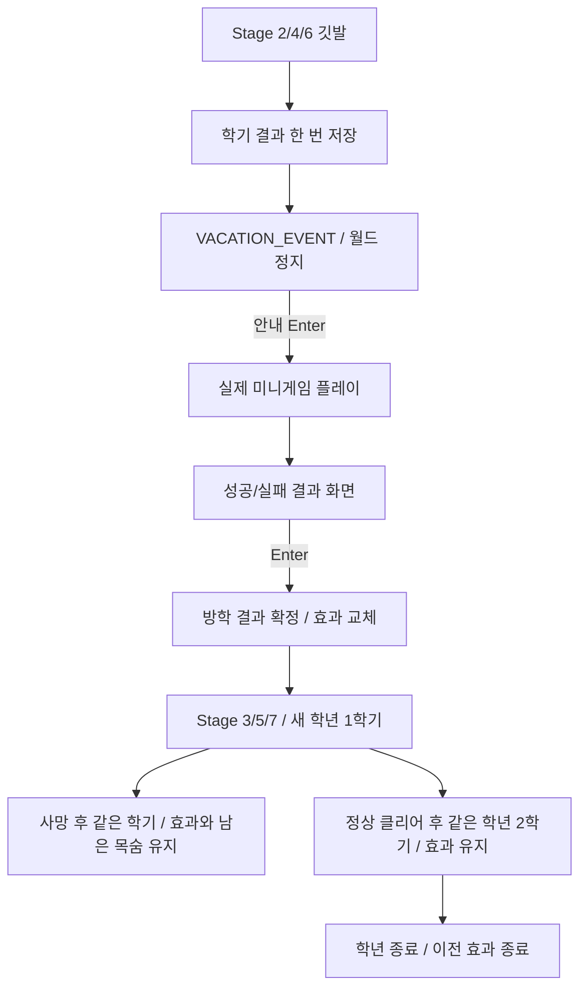

# Campus Runner — 방학 시스템 (STEP 9-1 / STEP 9-2 / STEP 9-3)

학년 사이에 실제 카페·자격증·해커톤 미니게임을 실행한다.
안내 → Enter → 플레이 → 결과 → Enter → 다음 학년 순서로 진행하며,
게임이 판정한 결과를 한 번 확정해 다음 학년 두 학기에 효과를 적용한다.
STEP 9-1의 임시 S/F 성공·실패 선택은 제거했다.
세 게임의 상세 규칙과 검증은 [VACATION_MINIGAMES.md](VACATION_MINIGAMES.md)를 따른다.

## 이벤트 발생과 상태

| 클리어한 학기 | 방학 이벤트 | 적용 학기 |
| --- | --- | --- |
| Stage 2 (1-2) | 카페 아르바이트 | Stage 3·4 (2학년) |
| Stage 4 (2-2) | 자격증 공부 | Stage 5·6 (3학년) |
| Stage 6 (3-2) | 해커톤 | Stage 7·8 (4학년) |

Stage 2·4·6의 깃발에 도착하면 기존 `recordStageResult()`로 해당 학기 결과를 저장한 뒤
바로 `VACATION_EVENT`에 진입한다. Enter로 방학을 건너뛰지 않는다.
Stage 1·3·5·7은 기존 STAGE_CLEAR → Enter → 다음 학기 흐름을 유지한다.
Stage 8은 GAME_COMPLETE 성적표 → Space → 졸업 엔딩 → Enter 새 게임을 유지한다.



이벤트 중에는 플레이어·중력·충돌·이동 발판·적·가시·아이템 수집을 갱신하지 않는다.
완료한 학기의 Stage 번호와 런타임을 그대로 보존하고 다음 학기를 미리 로드하지 않는다.
이벤트에서 기다려도 결과·보너스·사망 횟수·점수는 바뀌지 않는다.

## 결과와 효과 모델

- `VacationEventType`: 발생 Stage, 다음 대상 학년, 이벤트 이름과 성공/실패 설명.
- `VacationResult`: 이벤트 종류·성공 여부·불변 PlayerModifier를 보존한 확정 결과.
- `PlayerModifier`: 효과 출처·성공 여부·대상 학년·이동 배율·점프 배율·추가 시작 목숨.
- `VacationManager`: 대기 중 이벤트, 세 이벤트 결과 기록, 활성 효과 하나를 관리한다.

| 활동 | 결과 | 이동 배율 | 점프 배율 | 학기 시작 추가 목숨 |
| --- | --- | ---: | ---: | ---: |
| 카페 | 성공 | 1.00 | 1.00 | +1 |
| 카페 | 실패 | 0.95 | 1.00 | 0 |
| 자격증 | 성공 | 1.00 | 1.10 | 0 |
| 자격증 | 실패 | 1.00 | 0.95 | 0 |
| 해커톤 | 성공 | 1.10 | 1.00 | 0 |
| 해커톤 | 실패 | 0.95 | 1.00 | 0 |
| 효과 없음 | 해당 없음 | 1.00 | 1.00 | 0 |

Player는 불변 효과를 하나 전달받고, 기존 2인자 생성자는 NONE을 사용한다.
기본 MOVE_SPEED=260, JUMP_SPEED=650, GRAVITY=1700은 변경하지 않았다.

```text
effectiveMoveSpeed = 260 * moveSpeedMultiplier
effectiveJumpPower = 650 * jumpPowerMultiplier
semesterMaxLives = 5 + extraStartingLives
```

속도 0.95는 247, 1.10은 286이다. 점프력 0.95는 617.5, 1.10은 715다.
점프력 배율은 초기 점프 속도에만 적용하며, 중력·낙하 속도 제한·착지·발판 충돌 알고리즘은 유지한다.
이전 배율에 곱하는 방식이 아니라 새 불변 값을 교체하므로 재시작이나 중복 콜백으로 누적되지 않는다.

## 목숨·지속·종료

카페 성공 때만 Stage 3과 Stage 4의 시작 목숨이 각각 6개다.
학기 내 사망은 1개를 차감하고 남은 목숨으로 같은 학기를 자동 재시작하며, 효과와 학기 사망 횟수는 유지한다.
따라서 6개인 학기는 5번 사망해도 목숨 1개로 계속하고, 6번째에 GAME_OVER가 된다.
Stage 3에서 목숨을 잃었더라도 정상적으로 Stage 4에 진입하면 다시 6개다.
Stage 5부터는 카페 보너스가 없어 기본 5개를 사용한다.
HUD의 LIVES 분모와 하트 개수도 해당 학기의 실제 최대 목숨을 사용한다.

Stage 4·6에서 새 방학에 들어갈 때 이전 학년 효과를 종료하며, 새 결과를 확정하면 그 효과 하나로 교체한다.
`modifierForStage()`는 대상 학년이 아닌 Stage에 NONE을 반환한다.
`enterStage()`도 다른 학년에 진입하면 활성 효과를 제거하므로 종료된 효과가 다시 살아나지 않는다.
과거 VacationResult는 기록으로 남지만 능력치를 중첩시키지 않는다.

TITLE_SCREEN의 최초 Enter, GAME_OVER Enter, 졸업 엔딩 Enter 모두 기존 `startNewGame()`을 사용한다.
여기서 방학 대기·세 결과 기록·활성 효과를 지운 뒤 Stage 1을 로드한다.
점수·학기별 사망·TOTAL DEATHS·생존 보너스 등 기존 초기화도 함께 유지한다.
GAME_OVER에 머무는 동안에는 방학 기록과 기존 점수/사망 기록을 즉시 지우지 않는다.

## 실제 미니게임 UI와 입력

기존 800×600 UI FitViewport·ShapeRenderer·SpriteBatch·BitmapFont로 안내·플레이·결과를 별도로 그린다.
VACATION_EVENT 내부 `VacationMinigame.Phase`는 INTRO / PLAYING / RESULT다.
카페는 좌우 이동·30초 받기, 자격증은 방향키 기억·40초 5라운드,
Stage 6 이후 해커톤은 SERVER CONNECTION(서버 연결하기)이다.
네 방향키로 격자 커서 이동·Space로 타일 90도 회전·Enter로 양방향 회로 연결을 검사하며,
45초 내 4×4·5×5·6×6 세 보드를 해결해야 한다. 잘못된 검사 3회 또는 시간 초과면 실패한다.
연결 여부는 회전 배열 비교가 아닌 PC에서 서버까지의 BFS로 판정한다.
카페와 자격증은 STEP 9-2 구현을 그대로 유지한다.

S/F는 어떤 단계에서도 결과를 결정하지 않는다. ESC도 플랫포머를 재개하지 않는다.
깃발 도착 프레임에는 안내 입력을, 안내 Enter 프레임에는 플레이 입력을 처리하지 않는다.
결과가 나온 프레임의 Enter를 다시 결과 확인에 사용하지 않으며,
결과 확인 프레임에도 다음 월드를 갱신하지 않는다.

## 결과 연결 API

실제 활동이 끝나고 결과 화면에서 Enter를 누르면 **게임 스레드에서** 다음 메서드를 호출한다.

```java
boolean accepted = main.completeVacationEvent(VacationEventType.CAFE, true);
```

이벤트 종류와 게임이 판정한 성공 여부만 전달한다. false는 실패 결과이며, 반환값 false는
현재 이벤트가 아니거나 아직 게임이 끝나지 않았거나 실제 결과와 다르거나 이미 완료되었다는 뜻이다.
다른 스레드의 결과는 `Gdx.app.postRunnable(...)`로 게임 스레드에 전달해야 한다.
이 메서드는 상태·완료 여부·실제 결과·대기 종류를 확인하고 결과를 한 번 확정한 뒤 다음 학년 Stage를 로드한다.
현재 미니게임 객체는 결과 확인 또는 전체 재시작에서 제거한다.
미니게임 모델은 점수나 Player 기본 물리값을 직접 수정하지 않는다.

## 점수와 GPA

미니게임은 StageResult·아이템 점수·생존 보너스를 변경하지 않는다.
`survivalBonus = max(0, 20 - semesterDeathCount * 5)`를 그대로 사용한다.
카페 성공으로 5회 사망 후 클리어하더라도 보너스는 0이다.
최대 아이템 305 + 생존 보너스 160 = **465점**, 게임용 GPA 최대 **4.50**을 유지한다.
FinalReport·GraduationEnding 계산 코드는 변경하지 않았다.

## 시작 화면 기반 보존

작업 시작 시 `feature/vacation-system`은 졸업 엔딩까지 포함했으나,
요청에서 전제한 TITLE_SCREEN 코드는 해당 브랜치에 빠져 있었다.
이미 구현·검증된 `feature/start-screen`의 Main/GameState 시작 화면 부분,
TitleScreenVerification, docs/TITLE_SCREEN.md와 검증 호출을 파일 내용으로 복원했다.
브랜치 전환·Git merge는 실행하지 않았다. 시작 화면을 새로 설계하거나 재시작 규칙을 바꾸지 않았다.

## 자동 검증 결과

`.\gradlew.bat build` 성공. JDK 17 실행, Java 8 소스 호환 유지.
`VacationSystemVerification`, `VacationMinigamesVerification`, `ServerConnectionVerification`을 기존 Gradle 검증 체인에 연결했다.

| 항목 | 30fps | 60fps | 120fps |
| --- | --- | --- | --- |
| Stage 2/4/6에서 각 이벤트·결과 선저장 | 통과 | 통과 | 통과 |
| Stage 1/3/5/7 정상 전환·Stage 8 성적표 | 통과 | 통과 | 통과 |
| 이벤트 중 모든 월드·수집·기록 갱신 정지 | 통과 | 통과 | 통과 |
| S/F 결과 선택 불가·안내/플레이/결과 Enter 분리 | 통과 | 통과 | 통과 |
| 카페 성공 Stage 3·4 각각 목숨 6·사망 후 남은 목숨 유지 | 통과 | 통과 | 통과 |
| 5회 사망 후 클리어 보너스 0·6번째 사망 GAME_OVER | 통과 | 통과 | 통과 |
| 6가지 배율의 실제 입력 이동·점프·착지 | 통과 | 통과 | 통과 |
| 각 효과 두 학기 유지·이전 학년 종료·효과 교체 | 통과 | 통과 | 통과 |
| 중복/잘못된 콜백 거부·플레이 중 S/F 무효 | 통과 | 통과 | 통과 |
| GAME_OVER·엔딩 Enter로 모든 방학/점수/사망 기록 초기화 | 통과 | 통과 | 통과 |
| 최초 TITLE_SCREEN Enter에 효과 없는 기본 상태 | 통과 | 통과 | 통과 |
| 모든 이벤트 성공/실패 각각 만점 465·GPA 4.50 보존 | 통과 | 통과 | 통과 |
| 기존 Stage 1~8 실제 입력 경로·충돌·수집 회귀 | 통과 | 통과 | 통과 |
| 기존 목숨·성적표·GPA·5종 엔딩·시작 화면 회귀 | 통과 | 통과 | 통과 |
| 서버 회전·BFS·다른 경로·순환·3보드/45초/3실수·100개 seed | 통과 | 통과 | 통과 |

전용 생명주기 검증은 기존과 같은 아이템·깃발·추락 위치 픽스처로 실제 Main.update를 실행한다.
점수·사망·방학 결과를 테스트에서 직접 주입하지 않는다. 능력치 검증은 실제 이동/점프 입력과
플레이어 이동 거리·초기 수직 속도·착지를 확인하고, 기본 물리 상수가 그대로인지 대조한다.
실제 맵 경로 회귀는 카페 성공 → 자격증 실패 → 해커톤 실패를 거치는 연결 경로와
기존 독립 Stage 경로를 실행한다. 여섯 효과의 모든 조합으로 전체 맵을 완주했다고 주장하지 않는다.
모든 성공/모든 실패의 465점 검증은 점수/상태 전환 픽스처이며 실제 길찾기 검증과 구분한다.

기존 테스트는 Stage 2/4/6의 기대 상태만 VACATION_EVENT로 바꾸고,
`VacationVerificationSupport`에서 실제 미니게임에 키 입력을 재생해 결과를 얻고,
공개 완료 API로 명시적으로 이벤트를 마친다. 전용 통합 검증은 Main 입력부터 결과 Enter까지 모두 실행한다.
아이템 개수·충돌·착지·점수·보너스 검증 조건은 완화하지 않았다.

## GUI 확인과 수동 확인 항목

STEP 9-2에서 실제 LWJGL 창으로 세 게임의 안내/플레이/결과를 세 해상도에서 캡처했다.
세부 결과와 남은 수동 플레이 항목은 [VACATION_MINIGAMES.md](VACATION_MINIGAMES.md)를 따른다.

- Stage 2/4/6 깃발 도착 후 플레이 HUD가 사라지고 올바른 방학 이름과 두 효과가 표시되는지 확인.
- 이벤트 중 적·발판·가시가 멈추고 Enter·Space·ESC·화살표로 다음 학기를 시작할 수 없는지 확인.
- 각 게임의 성공/실패 결과를 확인한 뒤 새 학년의 1·2학기에서 효과가 유지되는지 확인.
- 서버 퍼즐의 방향키 이동·Space 회전·Enter 검사와 6×6 격자의 가독성을 확인.
- 카페 성공 시 Stage 3·4의 LIVES 6/6과 하트 6개가 겹치거나 잘리지 않는지 확인.
- 사망 재시작에는 남은 목숨을 유지하고, 다음 학기에는 6개를 회복하며 Stage 5에는 5개인지 확인.
- 자격증의 점프 높이 변화와 카페/해커톤의 이동 속도 변화가 느껴지는지 확인.
- 안내/결과 Enter를 누른 채로 화면이 연속 생략되지 않고 S/F로 결과를 고를 수 없는지 확인.
- 다양한 창 크기에서 긴 효과 설명과 안내가 겹치거나 잘리지 않는지 확인.
- GAME_OVER 및 엔딩 Enter 후 Stage 1이 효과 없이 초기화되는지 확인.

## 변경 파일

| 범위 | 파일 |
| --- | --- |
| 게임 연결·HUD·플레이어 배율 | Main.java, GameState.java, Player.java |
| 새 효과 모델 | VacationEventType.java, VacationResult.java, PlayerModifier.java, VacationManager.java |
| 새 전용 검증 | VacationSystemVerification.java, VacationVerificationSupport.java |
| 실제 게임과 UI | VacationMinigame.java, MinigameInput.java, CafeMinigame.java, CertificationMinigame.java, HackathonMinigame.java, VacationMinigameRenderer.java |
| 서버 회로 퍼즐 | CircuitTile.java, CircuitBoard.java, CircuitPuzzles.java, ServerConnectionVerification.java |
| 실제 게임 검증 | VacationMinigamesVerification.java, MinigameTestDriver.java |
| 전환 회귀 수정 | FreshmanLevelVerification.java, Semester2LevelVerification.java, SophomoreSemester2Verification.java, JuniorSemester2Verification.java, LifeSystemVerification.java, FinalReportVerification.java |
| 시작 화면 기반 복원 | TitleScreenVerification.java, docs/TITLE_SCREEN.md (Main/GameState 및 호출 포함) |
| 문서 | docs/VACATION_SYSTEM.md, docs/LIFE_SYSTEM.md |

StageFactory·StageDefinition·맵 좌표·장애물 배치·충돌 알고리즘은 변경하지 않았다.
실제 미니게임 3종은 STEP 9-2에서 추가했다. 새 라이브러리와 Git commit·push·merge는 사용하지 않는다.
